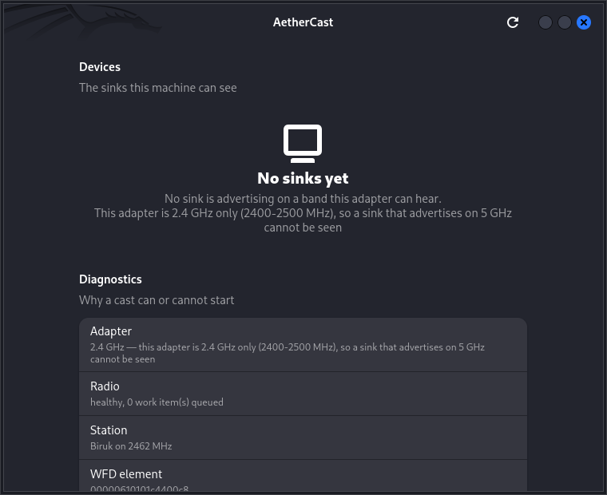

# AetherCast

> A best-in-class open-source casting app for Linux — starting with Miracast.

**Status: a working daemon, a published API, and a GTK4 client.**

## Why

GNOME Network Displays proved that Linux screen casting is possible, but it is still fragile: discovery depends on the Wi-Fi radio and desktop portal, error messages are cryptic, audio setup can crash, and protocol support is narrow. AetherCast aims to be the reliable, transparent, cross-desktop alternative:

- **Discovery that explains itself** — show why a TV is not visible instead of an empty list.
- **One-click casting** — sane defaults, quality/latency presets, and fast recovery.
- **Protocol-honest** — Miracast first, then Google Cast, AirPlay, and DLNA through a modular provider architecture.
- **Works on real hardware** — including single-radio laptops, X11 and Wayland, and common Wi-Fi chipsets.
- **Diagnostics built in** — exportable logs, compatibility reports, and a CLI/headless mode.
- **Open source, upstream-first** — reuse and contribute to GStreamer, wpa_supplicant, NetworkManager, and PipeWire rather than forking the world.

## Scope

**v1:** Linux Miracast source (laptop → TV), X11 and Wayland, video + audio, discovery, pairing, and a usable GTK4 interface.

**Later:** Miracast sink, Google Cast, AirPlay/AirPlay 2, DLNA/UPnP, headless/kiosk mode, and a plugin API.

## Principles

1. **Evidence before code.** Every protocol claim and design decision is documented and cited.
2. **No DRM circumvention.** HDCP and protected-content limits are documented, not broken.
3. **The radio is the hard part.** Wi-Fi Direct, channel concurrency, and driver support drive the architecture.
4. **Fail visibly.** A user should always know what failed, why, and what to try next.
5. **Accessible by default.** Keyboard navigation, screen-reader labels, high contrast, and translated strings.

## The three crates

| Crate | What it is |
| --- | --- |
| [`aethercast-api`](crates/aethercast-api/) | the contract: the D-Bus names, the data types, the client proxy, and the published XML |
| [`aethercastd`](crates/aethercastd/) | the session daemon: the radio, the discovery, the media pipeline, and the D-Bus service |
| [`aethercast-client`](crates/aethercast-client/) | the GTK4 and libadwaita window, on top of the API |

The daemon and the client share the API crate, so they cannot drift apart:
the client never links the daemon, and the daemon never links the client.

## Status

- Five cited research notes, ~30,000 words, 393 sources — [`docs/research/`](docs/research/)
- Four ADRs: research-first scope, Rust + GStreamer architecture, GPL-3.0-or-later, the name decision — [`docs/adr/`](docs/adr/)
- A reproducible root cause for "GNOME Network Displays finds no sinks" — [`spike/01-radio-work-wedge-report.md`](spike/01-radio-work-wedge-report.md)
- `aethercastd`, the session daemon: radio health, the global WFD information element, Wi-Fi Direct discovery, the WFD RTSP handshake (M1–M7), and a specification-conformant media pipeline
- A media pipeline that conforms to the Wi-Fi Display specification — video PID `0x1011`, audio PID `0x1100`, RTP payload type 33, seven TS packets per datagram, PCR within 100 ms — checked by [`spike/04-media-conformance.sh`](spike/04-media-conformance.sh)
- **An end-to-end cast**: a source that screens, encodes, muxes and streams to a sink over RTP, with the stream validated by ffprobe — [`spike/19-end-to-end.sh`](spike/19-end-to-end.sh)
- **A published D-Bus API**, with the contract in [`dbus/`](dbus/) and a test that refuses to let it drift from the implementation
- **A GTK4 client**, which says *why* nothing was found instead of showing an empty list



```console
$ cargo run -p aethercastd -- doctor
interface        : wlan0
station          : home-net (02:00:00:00:00:02)  [connected]
channel          : 2412 MHz
radio-work queue : 0 item(s)
radio health     : ok
wfd element      : armed
  - id=0 body=00101c4400c8
  device type     : source  session available: true  TDLS preferred: false
```

Not yet proven: a cast to a **physical** Miracast sink. Every link of the
chain is proven — discovery, the RTSP handshake, the media pipeline, the
group interface — but the machine this was built on has a 2.4 GHz-only
adapter and no sink that advertises itself. The hardware run book is
[`docs/pc-test-checklist.md`](docs/pc-test-checklist.md), and
[`docs/compatibility.md`](docs/compatibility.md) records what is known
about real devices.

## Building

The daemon needs GStreamer; the client needs GTK4 and libadwaita.

```console
$ sudo apt install libgstreamer1.0-dev libgstreamer-plugins-base1.0-dev \
      libgtk-4-dev libadwaita-1-dev
$ cargo build --release
```

Run the daemon, then the client:

```console
$ ./target/release/aethercastd daemon     # serves the API on the session bus
$ ./target/release/aethercast              # the window
```

The daemon also works on its own:

```console
$ ./target/release/aethercastd discover    # search for sinks
$ ./target/release/aethercastd cast        # wait for a sink and stream to it
```

## Documentation

- [`docs/README.md`](docs/README.md) — documentation index
- [`docs/research/`](docs/research/) — cited protocol and platform research
- [`docs/adr/`](docs/adr/) — architecture decision records
- [`docs/architecture.md`](docs/architecture.md) — how the pieces fit together
- [`docs/pc-test-checklist.md`](docs/pc-test-checklist.md) — what to run on a machine with a radio and a sink
- [`docs/protocols/`](docs/protocols/) — sequence diagrams and packet flows
- [`JOURNAL.md`](JOURNAL.md) — the day-by-day build journal

## License

GPL-3.0-or-later — see [`LICENSE`](LICENSE) and [ADR-0003](docs/adr/0003-license-gpl3.md).

## Not affiliated with GNOME

AetherCast is an independent project. GNOME Network Displays is a separate project and a source of inspiration and prior art.
