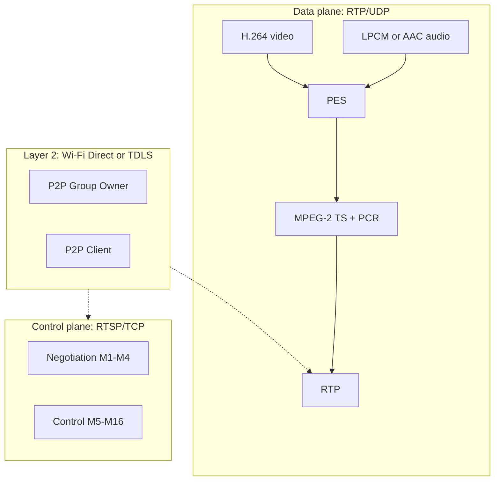
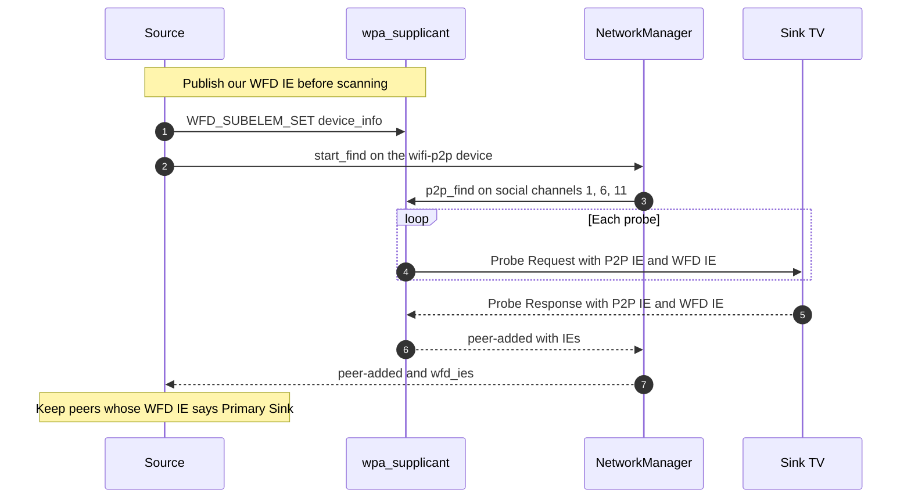
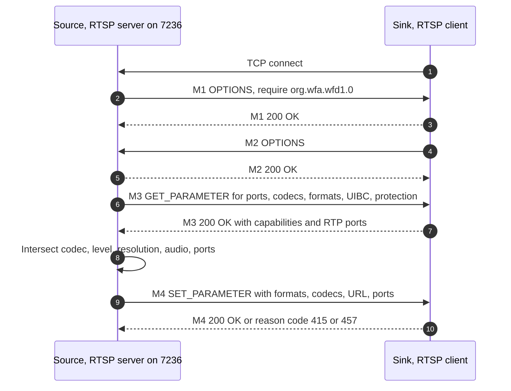
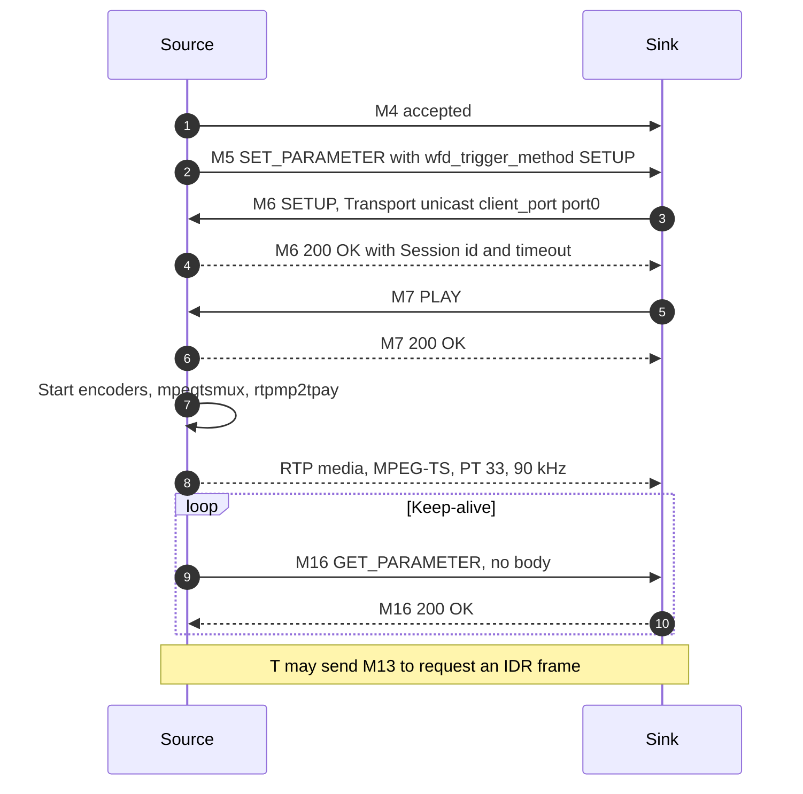
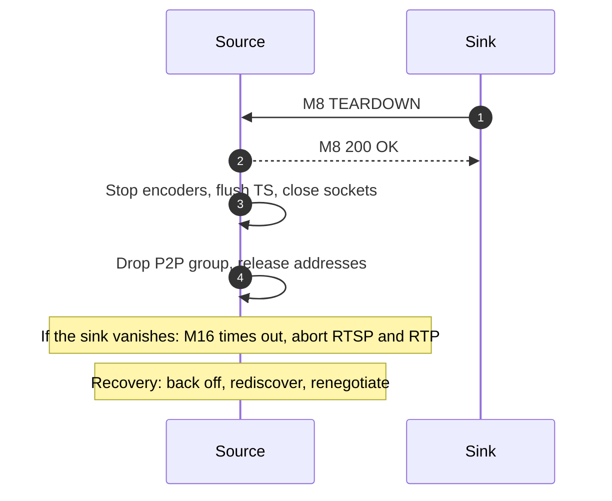
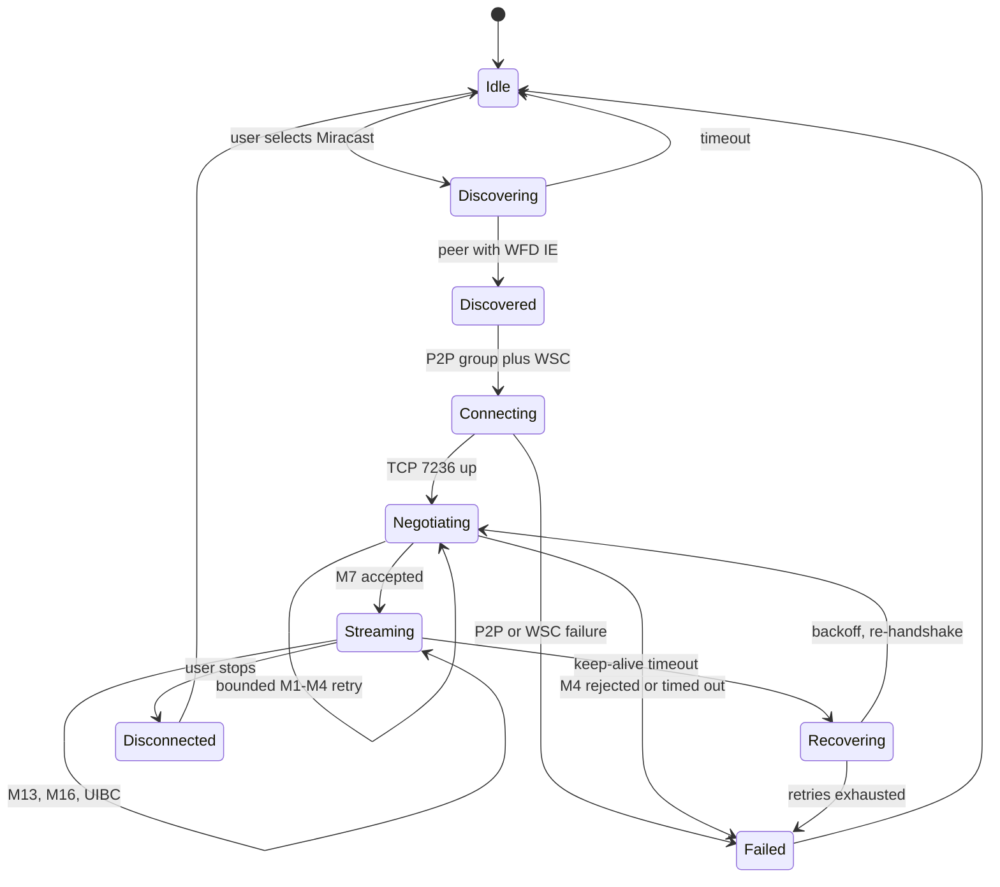
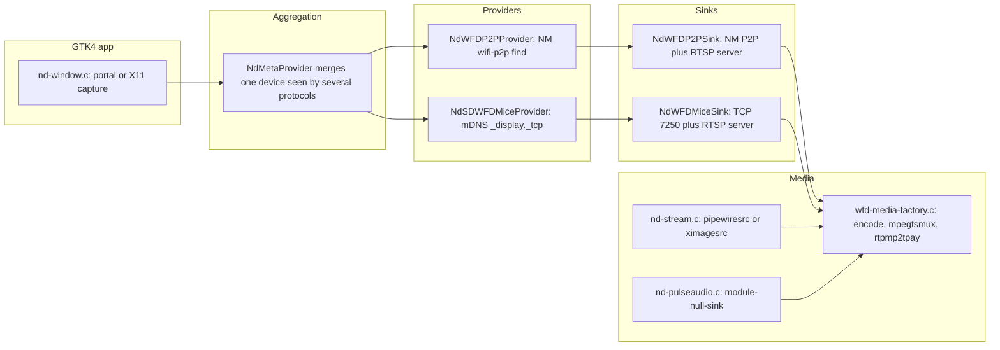

> **Naming note.** This note was written on 2026-10-20, when the project was still the codename "AetherCast". The project was renamed to **Castrel** the same day because the codename collided with prior art in this exact niche — see [ADR-0004](../adr/0004-codename-not-brand.md). "AetherCast" below refers to the codename.

# Research Note 01 — Miracast / Wi-Fi Display (WFD) and Wi-Fi Direct

**Status:** complete · **Date:** 2026-10-20 · **Track:** 1 of 5 (protocol + code audit)
**Scope:** WFD protocol deep dive, Wi-Fi Direct, and a code audit of GNOME Network Displays 0.99.0, MiracleCast and other open implementations — the foundation for AetherCast v1 (Linux Miracast **source**: laptop → TV).

**Evidence labels:** **verified** — read directly from a primary source (spec text, upstream source at a pinned tag) or reproduced locally with the command shown; **reported** — asserted by a second-hand source (vendor doc, upstream issue, README) we did not reproduce; **speculative** — our inference from verified facts, explicitly not proven.

Every factual claim carries a bracketed number resolving in [Sources](#14-sources); local output is cited as "[local]". Paywalled and NDA sources are flagged.

---

## 1. Executive summary

1. Miracast is a Wi-Fi Alliance *certification programme* over the **Wi-Fi Display (WFD)** spec: a **source→sink** protocol of **Wi-Fi Direct** link + **RTSP** control plane + **RTP/UDP** media plane carrying **MPEG-2 TS** [1].
2. The **sink initiates the TCP connection** to the source's RTSP control port (default **7236**); the source is the RTSP *server* [1 §4.5.4]. This inversion confuses most implementations, including GND.
3. WFD R1 (2012) is the only widely implemented generation: H.264 **Constrained Baseline, level ≤ 4.2**, mandatory **LPCM 2ch/16-bit/48 kHz** audio, discovery by **WFD IE in 802.11 frames** [1 §3.4, §5.1.1]. R2 (2017) adds mDNS discovery, HEVC, 4K, CTA audio, TCP transport, standby/resume and coupled sink [1 §4.4.1, §5.4].
4. **HDCP 2.x cannot be implemented by an open-source project**: the spec delegates key establishment to DCP LLC documents under NDA and signed licence [1 §4.7, App. F] [52]. Neither GND nor MiracleCast implements it, and AetherCast will not: detect a protection-requiring sink, refuse protected content, say why.
5. **GND 0.99.0 is a good skeleton with a broken core**: no **global** WFD IE during discovery (F1), second RTP port misread as RTCP producing a **reserved** combination (F2), **hard-coded 1920×1080p30** with native-resolution logic behind `#if 0` (F3), video clamped to **512 kbit/s** (F4), **500 ms** latency, **AAC-only** audio (F5–F6). (§7)
6. **The likeliest cause of "discovers no sinks" sits upstream of the RTSP code**: our wpa_supplicant has **no global WFD IE** (`wpa_cli get WFDIEs` → `FAIL`), and NetworkManager sets `wfd-ies` only at *activation*, never while scanning [4] [5]. **verified** for the configuration; **speculative** as the cause, pending a capture. The test hardware is **single-radio, 2.4 GHz-only** (QCA9565/AR9565, `ath9k`, `#channels <= 1`) [local], so sinks needing 5 GHz, or a GO channel unlike the AP's, are unreachable here regardless of software. **verified** (capability), **speculative** (sink behaviour).
7. **First build target:** a headless Miracast-source CLI — discovery → WFD IE → P2P → M1–M7 → MPEG-TS/RTP → M8 teardown — with a machine-readable event log, gated on a pcap-verified discovery milestone.

---

## 2. Scope, method, test environment

### 2.1 Method

We read the **Wi-Fi Display Technical Specification v2.1** (196 pp.) in full and extracted the sections that matter to a source implementation [1]; the PDF is a vendor-hosted copy of a membership-gated document, so treat pagination as authoritative but hosting as unofficial. We then read the full GND tree at tag `0.99.0` (commit `eba3ce5`, 2026-01-23) [8] and the MiracleCast tree at `0b7f1f1f` (2026-03-10) [37], and cross-checked against the local machine.

### 2.2 Test machine (local, **verified**)

| Item | Value |
| --- | --- |
| Kernel / distro | `6.19.14+kali-amd64`, Kali 2026.2, XFCE, X11 [local] |
| NIC / driver | QCA9565/AR9565, `ath9k` [local] |
| Bands | **Band 1 only** (2.4 GHz), ch. 1–13 (12/13 "no IR"), 14 disabled [local] |
| Concurrency | `#channels <= 1` — one channel at a time [local] |
| NetworkManager | 1.56.1; `wifi-p2p` device `p2p-dev-wlan0` present, disconnected [local] |
| wpa_supplicant | 2.10; `wpa_cli get WFDIEs` → **`FAIL`** (no global WFD IE) [local] |

**Limitation:** this environment cannot validate 5 GHz, concurrent station+P2P throughput, DFS or multi-radio hosts.

---

## 3. Protocol model

### 3.1 Roles, topology, Wi-Fi Direct

A **WFD Source** renders; a **WFD Primary Sink** displays; a **Secondary Sink** receives audio only in a *coupled sink* operation; type `0b11` is dual-role and must pick one role per session [1 §3.3.2, Table 29]. R1 requires a **Wi-Fi Direct** group (or TDLS); R2 may also run over infrastructure [1 §3.2, §4.5].

In a P2P group one side is **Group Owner (GO)** — owning the group beacon, group address and DHCP — the other a **P2P Client** [2] [3]. GO intent decides the role; a client can force it with `p2p_connect … pbc|pin` [3]. Provisioning uses **WSC** (PIN or PBC) [3]. `p2p_find` runs one full scan then only **social channels** (1/6/11 on 2.4 GHz) [3].



### 3.2 Version landscape

| Generation | Date | Discovery | Video | Audio |
| --- | --- | --- | --- | --- |
| WFD 1.0 (R1) | 2012-08-24 | WFD IE in Beacon/Probe Req/Resp | H.264 CBP/RHP, levels 3.1–4.2 | LPCM 2ch/16b/48 kHz mandatory; AAC, AC-3 optional |
| WFD 1.1 (R1) | 2014-04-24 | unchanged | unchanged | unchanged — "Public release for HDCPv2.2 updates" |
| WFD 2.0 (R2) | 2017-04-21 | adds **mDNS/DNS-SD** over infrastructure (`display._tcp`, `displaysrc._tcp`) | adds HEVC 3.1–5.1, 4K, H.264 to 5.2 | CTA formats, multi-channel LPCM |
| WFD 2.1 | 2017-07-31 | — | — | — |

**verified** [1 rev. history p. 3, §4.4.1, §5.4]. R2 is effectively unimplemented on Linux.

### 3.3 The WFD Information Element

A vendor-specific 802.11 IE: Element ID `0xDD`, OUI `50-6F-9A`, OUI Type `0x0A`, then subelements of the form `id(1) | length(2, big-endian) | body` [1 Tables 25–26]. Subelement IDs: 0 Device Information, 1 Associated BSSID, 2 Associated Source IP, 3 Alternate MAC Address, 4 Session Information, 5 Extended Capability, 6 Local IP Address, 7 UUID, 8–14 R2-specific [1 Table 27].

Device Information (id 0) [1 Table 29]:

| Bits | Meaning |
| --- | --- |
| 1:0 | type: `00` Source, `01` Primary Sink, `10` Secondary Sink, `11` dual-role |
| 2 / 3 / 5:4 | coupled-sink support at source / at sink; session availability (`01` = available) |
| 6–9 | WSD; PC (prefer TDLS); HDCP 2.x supported; 802.1AS time sync |
| 10 / 11 | audio unsupported / audio-only |

It also carries the **Session Management Control Port** (default **7236**) and **Maximum Throughput** in 1 Mbit/s units [1 Table 28].

GND's hard-coded IE `00 00 06 00 90 1c 44 00 c8` [12] decodes as: subelement `0x00`, length `6`, device info `0x0090` (Source, available, PC bit), control port `0x1C44` = **7236**, throughput `0x00C8` = **200 Mbit/s**.

### 3.4 Mandatory media

**Video:** H.264 [51] **Constrained Baseline level 3.1, 640×480p60** is mandatory; CBP/RHP 3.1–4.2 are optional, and 720×480p60 / 720×576p50 become mandatory when higher rates are supported [1 §3.4.2]. **Audio:** **LPCM 2ch, 16-bit, 48 kHz** is mandatory; AAC-LC 2/4/6/8 ch, AC-3 and LPCM 44.1 kHz are optional [1 §3.4.1].

A source unable to offer LPCM is non-conformant, and some sinks are strict about it — a recurring interop trap (F5, §7.5).

---

## 4. Discovery

### 4.1 The rule that matters

> "A WFD Device shall include the WFD Information Element (WFD IE) in all Beacon, Probe Request and Probe Response frames." [1 §4.3.2]

A device wishing to be discovered sets the **P2P Discoverability** bit [1 §4.5.2].



### 4.2 Where Linux breaks this

- wpa_supplicant appends the WFD IE to management frames only when the **global** `wfd_subelem[]` set is populated; otherwise `wifi_display_update_wfd_ie()` logs *"Wi-Fi Display disabled - do not include WFD IE"* [4]. That set is filled by the `WFD_SUBELEM_SET` control command [4]; **NetworkManager does not expose it**.
- NM's `wifi-p2p` setting has `wfd-ies`, but its docs say it is "only useful when implementing a Wi-Fi Display client" and is for "establishing a connection" [5]; NM applies it at *activation* only [7].
- Consequence: during scanning our Probe Requests carry **no WFD IE** — `wpa_cli get WFDIEs` returns `FAIL` [local]. **verified**.

**Speculative but high-plausibility:** a sink that filters Probe Requests by "must contain a WFD IE" never answers, so the peer list stays empty — the recorded symptom. A capture during a scan (`tcpdump -i wlan0 -w p2p.pcap`, filtered to Probe Request/Response) settles it in minutes. **speculative**.

### 4.3 Connectivity constraints (the hardware wall)

- The GO sits on one channel and clients follow; a single-radio adapter occupies only one channel, hence `#channels <= 1` and "STA/AP BI must match" [local] [62]. Acting as GO on channel 6 therefore interrupts the existing link on channel 1, and throughput is shared. **verified** (capability), **speculative** (impact on a given TV).
- The spec also offers **TDLS** and, for R2, infrastructure [1 §4.5]; neither is in GND.

---

## 5. Capability negotiation (RTSP M1–M4)

After the group is up, the **sink opens TCP to the source's control port**; the source is the RTSP server [1 §4.5.4]. WFD's method set is a profile of RFC 2326 [49]: `OPTIONS`, `GET_PARAMETER` and `SET_PARAMETER` both ways; `SETUP`, `PLAY`, `PAUSE` and `TEARDOWN` are sent by the **sink** [1 §6.2].



| Msg | Direction | Purpose |
| --- | --- | --- |
| M1 / M2 | S→T / T→S OPTIONS | mutual WFD support check |
| M3 / M4 | S→T GET_PARAMETER / SET_PARAMETER | source queries sink capabilities, then selects formats and ports |
| M5 | S→T SET_PARAMETER (`wfd_trigger_method: SETUP`) | triggers the sink's SETUP |
| M6 / M7 | T→S SETUP / PLAY | transport setup (`client-port`), then play |
| M8 | T→S TEARDOWN | teardown |
| M13 | T→S GET_PARAMETER (`wfd_idr_request`) | sink requests an IDR frame |
| M16 | S→T GET_PARAMETER (no body) | keep-alive |

**Timeouts** [1 §6.5]: 6 s to send M1 after connect; **5 s** per exchange; **6 s** between messages pre-session; 6 s (9 s with HDCP) between M6 response and M7; any violation aborts and returns both sides to RTSP Init. Keep-alive: the timeout goes in the M6 response `Session:` header (default 60 s, min 10 s) and M16 must be sent more often than *timeout − 5 s* [1 §6.5.1].

**RTP port rules — the most mis-implemented detail.** `wfd_client_rtp_ports` is `profile rtp-port0 rtp-port1 mode=play`, profile `RTP/AVP/UDP;unicast` [1 §6.1.10]:

| M3 response (sink) | Meaning | M4 request | M6 `client-port` |
| --- | --- | --- | --- |
| port0 non-zero, port1 = 0 | Primary sink, one MPEG-TS | port0 non-zero, **port1 = 0** | `rtp-port0` |
| port0 = 0, port1 non-zero | Secondary sink, audio only | port0 = 0, port1 non-zero | `rtp-port1` |
| both non-zero, or both 0 | **reserved** | — | — |

[1 Tables 89–90]. The second port is **not** RTCP: it is a second *RTP* port for a coupled secondary sink. A sink reporting `rtp-port1 = 0` is saying "one RTP stream"; rewriting that to `port0+1` produces a reserved combination.

**Other negotiated parameters** [1 §6.1]: `wfd_video_formats`, `wfd_audio_codecs`, `wfd_presentation_URL` (how the sink reaches the source's RTSP server), `wfd_display_edid`, `wfd_uibc_capability`, `wfd_content_protection`, `wfd_coupled_sink`, `wfd_idr_request`, plus R2's `wfd2_*` family. CEA resolutions run 0 = 640×480p60 … 16 = 1920×1080p24 [1 Table 34]; VESA 0 = 800×600p30 … 25 = 1680×1024p60, 28 = 1920×1200p30 [1 Table 35]; HH per Table 36 — the classic source of off-by-one bugs (F7, §7.5).

---

## 6. Session setup, streaming, teardown, recovery



### 6.1 Media plane

Audio and video elementary streams are packetised into **MPEG-2 TS** and carried by **RTP over UDP** [1 §4.10.2]:

- **Up to 7 TS packets (7 × 188 = 1316 bytes) per RTP packet**, sized so RTP+UDP+IP fits the MTU [1 §B.1].
- RTP **payload type 33** = MPEG2-TS [1 Table 110] [48], encapsulating MPEG-TS per RFC 2250 [46] over RTP [47]; the marker bit marks a discontinuous timestamp.
- RTP timestamp is **90 kHz**, derived from the source master clock and aligned to the TS **PCR** [1 §4.10.2].
- A/V sync rides on the embedded **PCR**; the spec warns Wi-Fi jitter can break naive clock recovery and offers optional IEEE 802.1AS/gPTP sync, flagged in the WFD IE [1 §4.10.1].

The payloader is RTP-MP2T (`rtpmp2tpay`) [56]; the muxer's `alignment=7` produces the 7-packet grouping the spec expects [57].

### 6.2 Teardown and recovery



Any timeout violation aborts the RTSP procedure and returns both devices to **RTSP Init**; a missing M16 response aborts RTSP and RTP [1 §6.5].



### 6.3 UIBC (User Input Back Channel)

Optional; carries sink-side input (mouse, touch, keyboard, remote) to the source over a dedicated **TCP** port advertised in `wfd_uibc_capability` (`port=`), negotiated in **M4/M14** and toggled in **M15** [1 §4.11.2, §6.1.15–6.1.16], and announced by bit 0 of the WFD Extended Capability subelement [1 Table 47]. Generic input packets carry a common header plus an input body; HIDC messages add an input path [1 §4.11.1, §4.11.3]. **No open Linux source implements UIBC on the source side.**

### 6.4 HDCP — the boundary

Link content protection uses **HDCP 2.x**. If both ends support it, source and sink complete **session key establishment *before* any RTP session**; AKE, locality check and SKE travel over a **separate TCP connection** whose port the sink advertises via `wfd_content_protection`, with the sink as TCP server [1 §4.7]. If key establishment fails, the sink may still send M7, but the source may then transmit only unprotected content [1 §4.7].

**The licensing boundary (verified):** the spec does not define HDCP — it delegates to DCP LLC documents (HDCP 2.0/2.1/2.2 adaptation plus the HDCP License Agreement) in Appendix F [1], distributed under NDA and a signed licence [52]. **There is therefore no lawful path for an open-source project to implement HDCP 2.x**, and none of the audited implementations attempts it. AetherCast's position is a *product* one: detect a sink that requires protection, refuse protected content and say why, never attempt to bypass or strip it, and do not offer protected browser surfaces as capture sources.

### 6.5 MS-MICE (Microsoft's infrastructure variant)

MS-MICE replaces P2P with an infrastructure path: the sink advertises itself, the source reaches it over the LAN, signalling uses **TCP 7250** and media uses **RTSP 7236** [53] [54]. It defines a "Source Ready" message (friendly name, RTSP port, source ID) plus optional **DTLS** transport security and **PIN** pairing [53]. GND sends only a bare Source Ready (hostname + port 7236 + a 16-byte source ID) and connects to TCP 7250, with **no** security handshake and **no** PIN exchange [19]; its mDNS provider browses only `_display._tcp` [20].

---

## 7. Audit — GNOME Network Displays 0.99.0

**Provenance:** tag `0.99.0`, commit `eba3ce5` (2026-01-23), ~20 kLOC of C [8]; licence **GPL-3.0-or-later** [24]. GObject-based, with a `NdProvider`/`NdSink` interface pair.



### 7.1 Provider architecture

`NdProvider` exposes `get_sinks()` plus `sink-added`/`sink-removed`; `NdSink` exposes `start_stream`/`stop_stream`/`to_uri` and a `state` property [9] [10]. `NdMetaProvider` merges protocol-level sinks referring to the same physical display into one entry [8] — a clean seam, directly reusable as AetherCast's provider contract.

### 7.2 NetworkManager P2P usage

- Discovery calls `nm_device_wifi_p2p_start_find()` on every device state change and re-arms every **20 s** [11] [6]. There is **no** call setting a global WFD IE — only a per-connection `wfd-ies` at activation [12]. **verified**.
- Peers surface only if `nm_wifi_p2p_peer_get_wfd_ies()` is non-empty; peers without WFD IEs are ignored but watched for later change [11].
- Connection: a volatile `NMConnection` with `wifi-p2p` (peer + `wfd-ies`), `ipv4.method=auto` + `never-default`, `ipv6.method=auto` + `may-fail` [12]. NetworkManager maps `auto` to **`shared`** when the local device becomes P2P **Group Owner**, and to the GO-assigned address when it is the client [7] — addressing is handled correctly.
- A firewalld zone `P2P-WiFi-Display` is created and attached before activation [12], so the flow **hard-depends on firewalld** — a hard failure elsewhere; issue [#446][34] asks for a retry.

### 7.3 GStreamer pipeline

Capture (`pipewiresrc` from an XDG ScreenCast portal session [55], else `ximagesrc`) → `videoconvert`/`videoscale` → caps filter at the chosen resolution → encoder (`openh264enc`, `x264enc`, `vah264enc`, `vaapih264enc`) → `h264parse` → profile caps → `mpegtsmux` (`alignment=7`) → `rtpmp2tpay` → UDP [16] [22] [23]. Audio: PulseAudio `module-null-sink` [58] → `pulsesrc` → AAC encoder [16] [21] (PipeWire-based capture and routing are the modern equivalent) [61]. RTP session: `rtp-profile=avp`, `do-retransmission=TRUE`, `max-misorder-time=50`, `latency=40` [17].

### 7.4 RTSP/WFD handling

GND's WFD source is an **RTSP server** (`gst_rtsp_server_attach` on `0.0.0.0:7236`, mount `/wfd1.0`) plus a bespoke `GstRTSPClient` subclass modelling the *sink's* client behaviour [13] [18]. The naming is inverted relative to the spec — a readability hazard.

### 7.5 Findings

| # | Finding | Severity | Evidence |
| --- | --- | --- | --- |
| F1 | **No global WFD IE during discovery** — our Probe Requests carry none, so sinks requiring one never answer. | High | [11] provider.c:83-99,201-216; [12] sink.c:547-558; [4]; [5] |
| F2 | **RTP port misuse** — port1 is treated as RTCP and rewritten to `port0+1` when the sink reports `0`, producing a **reserved** combination. | High | [14] params.c:227-245; [1 Tables 89-90]; issue [#482][31] |
| F3 | **Resolution selection disabled** — the native/best-resolution path is behind `#if 0`; the code always uses **1920×1080p30**, even if unadvertised. | High | [13] client.c:118-170; issues [#415][36], [#416][35] |
| F4 | **Video clamped to 512 kbit/s** regardless of level. | High | [16] media-factory.c:528-533 |
| F5 | **AAC-only audio** — mandatory LPCM 2ch/16b/48 kHz unimplemented. | Medium | [16] media-factory.c:685-686; [1 §3.4.1] |
| F6 | **500 ms hard-coded pipeline latency**, ≈0.4 s visible lag. | Medium | [16] media-factory.c:504-507; issue [#507][25] |
| F7 | **Resolution table typos** — CEA 10 is `1290×720p25` (spec 1280×720p25), CEA 16 is `1920×1080p25` (spec p24), VESA 25 duplicates `1680×1024p30` (spec p60). | Medium | [15] video-codec.c:6-79; [1 Tables 34-35] |
| F8 | **RTSP server binds `0.0.0.0:7236`, unauthenticated**; "bind only to the P2P device" is a comment. | Medium | [18] server.c:210-214; [12] sink.c:461-465 |
| F9 | **M3 query omits most optional capabilities** (`wfd_uibc_capability`, `wfd_content_protection`, `wfd2_*`), and EDID / `microsoft_cursor` are parsed but unused; `wfd_audio_codec_copy()` drops every field. | Medium | [14] params.c:6-31, 324-390, audio-codec.c:33-43 |
| F10 | **Errors are `g_warning` plus a terminal `ND_SINK_STATE_ERROR`** — no taxonomy, no retry policy, no actionable cause. | Medium | [10] nd-sink.h:31-38; [12] |
| F11 | **Portal-only capture with a silent X11 fallback** — on Wayland without a portal, `ximagesrc` is used and crashes. | Medium | [23] nd-window.c:320-340; issue [#504][24b] |

### 7.6 Upstream issue signal (reported)

[#507][25] 500 ms latency · [#503][26] stream freezes after ~1 s · [#498][27] Wi-Fi Display QoS throttling · [#497][28] fails on CQP-only VA drivers · [#496][29] PulseAudio teardown crash · [#476][30] blank output after connecting · [#482][31] drops on Roku/Hisense — the issue models port1 as RTCP · [#470][32] disconnect after ~30 s (keep-alive) · [#459][33] P2P activation timeout · [#415][36] "No resolution found, falling back to standard FullHD".

### 7.7 Reuse assessment and GPL-3.0 implications

**Reusable as ideas, not code:** the provider/sink seam, meta-provider merge, capability model, WFD-IE layout, M1–M7 choreography — facts and structures, not copyrightable expression.

**Reusable as code:** everything in `src/wfd/` and `src/nd-wfd-*.c` is **GPL-3.0-or-later** [24]. Copying or adapting it makes AetherCast a derivative work: the whole distributed application must be GPL-3.0 (or compatible) with complete corresponding source, build scripts included. Linking GPL code into an MIT/Apache application is no way around this.

Consequences (our judgement, not legal advice):

- For a permissive licence we must **not** copy GND: we implement from the specification and may consult the Apache-2.0 AOSP `wifi-display` [44] and LGPL-2.1 MiracleCast/Intel WDS [37] [42] as *reference* while keeping our own expression.
- For GPL-3.0 we could reuse GND outright, inheriting years of interop work, at the cost of viral effect on integrators and the no-proprietary-addons clause (moot, since we ship no closed HDCP helper). GPL-3.0 also grants an express patent licence and forbids anti-tivoization measures — acceptable for a desktop/Flatpak app.

**Recommendation:** keep AetherCast permissively licensed (Apache-2.0) and treat GND as a read-only reference; port *behaviour* in fresh code and cite it.

---

## 8. Other open implementations

### 8.1 MiracleCast

| Aspect | Assessment |
| --- | --- |
| Scope | **Sink only** — the README states the Display-Source side "is not implemented yet" [38] |
| Architecture | `wifid` D-Bus daemon (manages wpa_supplicant P2P), `miracle-sinkctl` CLI, hand-written RTSP server [39], own DHCP server, `uibc-viewer` helper [40] [41] |
| Coverage | Full R1 sink: M1–M9, UIBC, content protection `none`; advertises **AAC only** and H.264 masks defaulting to all CEA bits `0x0001ffff` [39] [41] |
| Maintenance | Sporadic: last commit 2026-03-10, ~94 open issues [37] |
| Licence | **LGPL-2.1+**, with the DHCP component under **GPL-2** [37] |

**Strengths:** complete sink, UIBC implemented, independent of NetworkManager, and therefore valuable as a *test peer*. **Weaknesses:** no source side, no R2/HEVC, AAC-only, no vendor backing.

### 8.2 Intel WDS

Intel's "Wireless Display Software for Linux OS" provides `libwds` — a connection-manager-agnostic WFD dialect of RTSP with both sink and source negotiation — plus `sink` and `desktop_source` examples on GStreamer and **ConnMan** [42] [43]. It is the closest prior art to a full source, and its `rtsp-message-exchanges.txt` is a useful flow reference. **Weaknesses:** discontinued by Intel and archived in 2022, and it targets ConnMan rather than NetworkManager [42] [43].

### 8.3 AOSP `wifi-display`

Android's `frameworks/av/media/libstagefright/wifi-display` implements a WFD source and sink (RTSP server/client, RTP, UIBC) under **Apache-2.0** — the only permissively licensed reference here [44]. Removed from current AOSP branches but present in `android-8.1.0_r81`: old, Android-coupled, low reuse value, licence-clean.

### 8.4 Others

`albfan/gst-rtsp-server-wfd` is a 2014-era GStreamer RTSP-server module for the Miracast *source* side [45] — historical reference only.

| | GND 0.99.0 | MiracleCast | Intel WDS | AOSP | AetherCast (target) |
| --- | --- | --- | --- | --- | --- |
| Role | Source | Sink | Both | Both | Source (v1) |
| Licence | GPL-3.0 | LGPL-2.1 (+GPL-2 DHCP) | LGPL-2.1 | Apache-2.0 | Apache-2.0 (proposed) |
| R2 / HEVC / 4K | no | no | no | no | no (v1) |
| UIBC | no | yes (sink) | partial | yes | planned v4 |
| HDCP | no | no | no | no | **out of scope by design** |

---

## 9. What a best-in-class Linux Miracast source must add over GND

1. **Correct discovery** — publish a global WFD IE before scanning; read device type, port and availability from the sink's WFD IE; distinguish "device seen but not a WFD sink" from "no devices seen".
2. **Real capability negotiation, quality and audio** — typed capability model; intersection over codec/profile/level/resolution/refresh/audio/ports; spec-correct RTP-port handling; request all optional parameters; map WFD reason codes (415, 457, 401, 453…) to actionable messages; choose from the sink's advertised CEA/VESA/HH bitmaps rather than a hard-coded 1080p30; respect level-derived bitrate ceilings; implement **LPCM 2ch/16-bit/48 kHz** (mandatory) with AAC optional; measure end-to-end latency.
3. **Correct lifecycle and hardening** — M8 teardown, keep-alive per the `timeout − 5 s` rule, bounded reconnection with backoff, guarded state machine, RTSP bound to the P2P interface only, optional PIN/DTLS where supported, firewall handling that does not assume firewalld, and survival of portals, PipeWire and PulseAudio vanishing mid-stream.
4. **Diagnostics and interop breadth** — exportable event log, per-stage timings, the exact RTSP messages, a one-command compatibility report, and at least one tested WFD R1 sink profile per release plus a local MiracleCast sink in CI.

---

## 10. AetherCast recommendations

### 10.1 Provider architecture

Keep GND's seam, sharpen it, and keep the media pipeline protocol-independent:

```
aethercast/
  core/        # session state machine, capability model, error taxonomy, event bus
  providers/   # miracaast (WFD R1), msrc (MS-MICE); later cast, airplay, dlna
  transport/   # p2p via NM + wpa_supplicant, mDNS, TCP/RTP helpers
  media/       # capture (portal/X11), encode, mux, RTP, audio
  ui/          # GTK4 app and CLI
  diagnostics/ # structured log, report export, capture helpers
```

Rules: (a) **providers never touch the pipeline** — they return a negotiated `SessionPlan`; (b) **the pipeline never speaks RTSP**; (c) every provider implements the same lifecycle, so adding Google Cast is a new provider, not a new app; (d) one shared capability model answers "does this sink do HEVC?" before connecting.

### 10.2 Session state machine

`Idle → Discovering → Discovered → GroupForming → Connected → Negotiating → Streaming → Recovering → Failed → Disconnected`. Every transition is a named event with a guard (timeout, error code, user action) and emits a structured log record. Transport detail (P2P vs MICE) is a *strategy* behind `GroupForming`/`Connected`, so the machine is protocol-independent.

### 10.3 Error taxonomy

| Code | Detection | User message (abridged) | Recovery |
| --- | --- | --- | --- |
| `DISCOVERY_NO_WFD_IE` | peer found, WFD IE empty | "Not a Miracast receiver" | informational |
| `DISCOVERY_TIMEOUT` | no eligible peer in N s | "No Miracast screens found" | rescan; suggest 5 GHz dongle |
| `P2P_GROUP_UNSUPPORTED` | `p2p_connect` fails, no GO capability, or GO channel ≠ AP channel | "This adapter cannot host a Wi-Fi Direct group, or stay on the AP and TV channels at once" | try client role; suggest 5 GHz |
| `RTSP_M4_REJECTED_415` / `_457` | M4 reason code 415 or 457 | "Unsupported picture format" / "Unsupported codec profile or level" | renegotiate lower resolution, Baseline profile or level |
| `RTSP_KEEPALIVE_LOST` | no M16 response before timeout | "The TV disconnected" | reconnect, backoff 1/2/5 s, max 3 |
| `MEDIA_NO_ENCODER` | no usable H.264 encoder | "No video encoder available" | list encoders searched |
| `MEDIA_LATENCY_HIGH` / `AUDIO_UNAVAILABLE` | latency over budget / no monitor source | "High latency detected" / "No system audio found" | suggest lower bitrate / offer video-only |
| `HDCP_REQUIRED` | sink requires protection | "This screen requires DRM protection, which AetherCast does not implement" | stop; never bypass |
| `FIREWALL_BLOCKED` | TCP 7236 refused or timing out | "The firewall is blocking the connection" | detect firewalld/ufw; offer a command |
| `PORTAL_UNAVAILABLE` | portal method missing | "Screen capture permission is required" | explain; X11 fallback only on X11 |

### 10.4 Test strategy

1. **Unit** — capability-intersection tables; WFD IE round-trips; M4 body golden files compared byte-for-byte with the spec.
2. **Conformance fixtures** — recorded RTSP dialogues replayed against a mock sink that asserts spec values (e.g. `rtp-port1 = 0` for a single-stream sink).
3. **Loopback integration** — a mock sink plus **MiracleCast as a real sink** on the same host [37].
4. **Fault injection** — kill the TCP connection at each RTSP stage, drop responses, corrupt RTP, remove the P2P group, power off the sink mid-stream; assert recovery per §6.2.
5. **Hardware matrix** — single-radio 2.4 GHz / 5 GHz, dual-radio, AP-less, 802.11ax; recorded in `docs/compatibility.md` with evidence links.
6. **Diagnostics and packet evidence** — every failure must yield a report bundle (state transitions, RTSP messages, timings, capability snapshot); capture-based tests assert the WFD IE appears in our Probe Requests, settling F1 empirically.

### 10.5 First build target

**Milestone 1 — "handshake":** a headless CLI (`aethercast-wfd --discover`) that sets the global WFD IE through the wpa_supplicant control interface, starts a P2P find, lists WFD-capable sinks with device type, control port and throughput, and exports a pcap-ready diagnostic bundle. *Exit criteria:* the test TV appears and a pcap shows our WFD IE in the Probe Request, which alone answers "discovers no sinks".

**Milestone 2 — "session":** full M1–M4 negotiation and a still image over MPEG-TS/RTP. *Exit criteria:* the TV shows a picture and the M4 body is spec-conformant, including `rtp-port1 = 0`.

**Milestone 3 — "video":** live video at 720p30/1080p30 with a resolution *selected from the sink's bitmap*, bitrate tied to the negotiated level, measured latency.

**Milestone 4 — "audio + teardown":** LPCM plus optional AAC, A/V sync measurement, clean M8 teardown, reconnect on demand.

Out of scope for v1: HDCP/DRM bypass, sink mode, R2/HEVC/4K, TCP transport, coupled sink, standby/resume.

---

## 11. Bottom line for AetherCast

Miracast-on-Linux is solved but unpolished. The protocol is documented and the media path is standard; the hard parts are (1) getting the WFD IE onto the wire during discovery, (2) honouring the capability contract exactly, and (3) surviving real hardware and real sinks. GNOME Network Displays proves the end-to-end path works and shows the *shape* of a good solution, but its negotiation core is wrong in four specific ways (F1–F4) and it is GPL-3.0 — so re-implement rather than fork. MiracleCast and Intel WDS are valuable as peers and references, not as a base. AetherCast v1 should be a small, correct, well-diagnosed Miracast **source** that negotiates per spec, picks a resolution the sink actually advertised, streams video with LPCM-capable audio, and explains every failure.

## 12. Open questions

1. **Does the test TV require a WFD IE in Probe Requests, and what are its capabilities?** Unproven; needs a pcap during a scan plus an M1–M3 exchange with our own client to read its resolution bitmap, level, audio modes and port conventions. If the WFD IE matters, F1 is the root cause; if not, the TV refuses P2P for another reason (channel, 5 GHz-only, P2P quirk). A 5/6 GHz USB dongle would separate "software bug" from "hardware limitation" in one test.
2. **Is the TV an MS-MICE device, and does it need LPCM or accept AAC-only?** If it advertises `_display._tcp` and TCP 7250, the infrastructure path may beat P2P on this radio; if it needs LPCM, F5 is a hard blocker.
3. **How do we set the global WFD IE without root?** NM does not expose `WFD_SUBELEM_SET`; we need a minimal privileged helper, control-socket access, or an NM patch. **An architectural decision, not an implementation detail.**
4. **Which licence path?** Apache-2.0 with clean-room reimplementation, or GPL-3.0 with direct reuse? This evidence favours Apache-2.0 plus fresh code, at the cost of re-deriving GND's quirks.

## 13. Risks

| Risk | Impact | Likelihood | Mitigation |
| --- | --- | --- | --- |
| **HDCP/DRM**: sinks requiring protection refuse or black-screen our stream. | High | High | Detect and refuse explicitly; document; never attempt circumvention [1 §4.7] [52] |
| **H.264 patents**: OpenH264's royalty cover applies to Cisco-distributed binaries, not self-built ones [59]; x264 is GPL [60]. | High | Medium | Prefer Cisco's prebuilt `openh264` or VA-API; document the position; avoid shipping x264 |
| **Single-radio hardware**: the reference machine cannot stream and stay associated at once. | High | Certain here | Capability check with a clear message; test on dual-radio |
| **Privilege for the global WFD IE.** | High | High | A tiny auditable helper with a minimal D-Bus surface; never ask for root |
| **Interop fragmentation** across Roku, Hisense, LG, Samsung, AltoBeam sinks [31] [32] [33], and **wpa_supplicant/NM churn** (`WFD_SUBELEM_SET` and `wfd_subelems` are not stable public APIs). | Medium | Certain | Compatibility matrix with evidence; mock plus real sink in CI; isolate wpa_supplicant interaction in one adapter with version guards |

## 14. Sources

All URLs retrieved 2026-10-20. "Local" = reproduced on the test machine (§2.2).

**Specifications and standards**

1. Wi-Fi Alliance, *Wi-Fi Display Technical Specification v2.1* (2017-07-31), 196 pp. — unofficial mirror (the alliance's own copy is membership-gated): <https://raw.githubusercontent.com/wiki/albfan/miraclecast/files/Wi-Fi_Display_Technical_Specification_v2.1_0.pdf>
2. Wi-Fi Alliance, *Wi-Fi Direct*: <https://www.wi-fi.org/discover-wi-fi/wi-fi-direct>
46. RFC 2250, *RTP Payload Format for MPEG-1/MPEG-2 Video*: <https://www.rfc-editor.org/rfc/rfc2250>
47. RFC 3550, *RTP*: <https://www.rfc-editor.org/rfc/rfc3550>
48. RFC 3551, *RTP Payload Types*: <https://www.rfc-editor.org/rfc/rfc3551>
49. RFC 2326, *RTSP*: <https://www.rfc-editor.org/rfc/rfc2326>
51. ITU-T Rec. H.264: <https://www.itu.int/rec/T-REC-H.264>
52. DCP LLC, *HDCP* (NDA-gated): <https://www.digital-cp.com/>
53. Microsoft, *[MS-MICE]*: <https://learn.microsoft.com/en-us/openspecs/windows_protocols/ms-mice/9598ca72-d937-466c-95f6-70401bb10bdb>
54. Microsoft, *Wireless Projection technical references*: <https://learn.microsoft.com/en-us/windows-hardware/design/device-experiences/wireless-projection-technical-references>

**Linux stack**

3. wpa_supplicant, *README-P2P*: <https://w1.fi/cgit/hostap/plain/wpa_supplicant/README-P2P>
4. wpa_supplicant, `wifi_display.c` (global WFD IE handling): <https://w1.fi/cgit/hostap/plain/wpa_supplicant/wifi_display.c>
5. NetworkManager, *wifi-p2p setting* (`wfd-ies`): <https://networkmanager.dev/docs/api/latest/settings-wifi-p2p.html>
6. NetworkManager, *Device.WifiP2P* D-Bus API: <https://networkmanager.dev/docs/api/latest/gdbus-org.freedesktop.NetworkManager.Device.WifiP2P.html>
7. NetworkManager 1.56.1, `nm-device-wifi-p2p.c` (GO ⇒ `shared` addressing): <https://gitlab.freedesktop.org/NetworkManager/NetworkManager/-/blob/1.56.1/src/core/devices/wifi/nm-device-wifi-p2p.c>
55. XDG Desktop Portal, *ScreenCast*: <https://flatpak.github.io/xdg-desktop-portal/docs/doc-org.freedesktop.portal.ScreenCast.html>
56. GStreamer, `rtpmp2tpay`: <https://gstreamer.freedesktop.org/documentation/rtp/rtpmp2tpay.html>
57. GStreamer, `mpegtsmux`: <https://gstreamer.freedesktop.org/documentation/mpegtsmux/mpegtsmux.html>
58. PulseAudio, *Modules* (`module-null-sink`): <https://www.freedesktop.org/wiki/Software/PulseAudio/Documentation/User/Modules/>
59. OpenH264 FAQ (royalty coverage): <https://www.openh264.org/faq.html>
60. x264 (licence): <https://www.videolan.org/developers/x264.html>
61. PipeWire documentation: <https://docs.pipewire.org/>
62. Linux Wireless Wiki, *ath9k*: <https://wireless.wiki.kernel.org/en/users/drivers/ath9k>

**GNOME Network Displays (tag 0.99.0, commit `eba3ce5`)**

8. Project tree: <https://gitlab.gnome.org/GNOME/gnome-network-displays/-/tree/0.99.0>
9. `src/nd-provider.h`: <https://gitlab.gnome.org/GNOME/gnome-network-displays/-/blob/0.99.0/src/nd-provider.h>
10. `src/nd-sink.h`: <https://gitlab.gnome.org/GNOME/gnome-network-displays/-/blob/0.99.0/src/nd-sink.h>
11. `src/nd-wfd-p2p-provider.c`: <https://gitlab.gnome.org/GNOME/gnome-network-displays/-/blob/0.99.0/src/nd-wfd-p2p-provider.c>
12. `src/nd-wfd-p2p-sink.c`: <https://gitlab.gnome.org/GNOME/gnome-network-displays/-/blob/0.99.0/src/nd-wfd-p2p-sink.c>
13. `src/wfd/wfd-client.c`: <https://gitlab.gnome.org/GNOME/gnome-network-displays/-/blob/0.99.0/src/wfd/wfd-client.c>
14. `src/wfd/wfd-params.c`: <https://gitlab.gnome.org/GNOME/gnome-network-displays/-/blob/0.99.0/src/wfd/wfd-params.c>
15. `src/wfd/wfd-video-codec.c`: <https://gitlab.gnome.org/GNOME/gnome-network-displays/-/blob/0.99.0/src/wfd/wfd-video-codec.c>
16. `src/wfd/wfd-media-factory.c`: <https://gitlab.gnome.org/GNOME/gnome-network-displays/-/blob/0.99.0/src/wfd/wfd-media-factory.c>
17. `src/wfd/wfd-media.c`: <https://gitlab.gnome.org/GNOME/gnome-network-displays/-/blob/0.99.0/src/wfd/wfd-media.c>
18. `src/wfd/wfd-server.c`: <https://gitlab.gnome.org/GNOME/gnome-network-displays/-/blob/0.99.0/src/wfd/wfd-server.c>
19. `src/nd-wfd-mice-sink.c`: <https://gitlab.gnome.org/GNOME/gnome-network-displays/-/blob/0.99.0/src/nd-wfd-mice-sink.c>
20. `src/nd-sd-wfd-mice-provider.c`: <https://gitlab.gnome.org/GNOME/gnome-network-displays/-/blob/0.99.0/src/nd-sd-wfd-mice-provider.c>
21. `src/nd-pulseaudio.c`: <https://gitlab.gnome.org/GNOME/gnome-network-displays/-/blob/0.99.0/src/nd-pulseaudio.c>
22. `src/stream/nd-stream.c`: <https://gitlab.gnome.org/GNOME/gnome-network-displays/-/blob/0.99.0/src/stream/nd-stream.c>
23. `src/app/nd-window.c`: <https://gitlab.gnome.org/GNOME/gnome-network-displays/-/blob/0.99.0/src/app/nd-window.c>
24. `COPYING` (GPL-3.0): <https://gitlab.gnome.org/GNOME/gnome-network-displays/-/blob/0.99.0/COPYING>
24b. Issue #504: <https://gitlab.gnome.org/GNOME/gnome-network-displays/-/issues/504>
25. Issue #507: <https://gitlab.gnome.org/GNOME/gnome-network-displays/-/issues/507>
26. Issue #503: <https://gitlab.gnome.org/GNOME/gnome-network-displays/-/issues/503>
27. Issue #498: <https://gitlab.gnome.org/GNOME/gnome-network-displays/-/issues/498>
28. Issue #497: <https://gitlab.gnome.org/GNOME/gnome-network-displays/-/issues/497>
29. Issue #496: <https://gitlab.gnome.org/GNOME/gnome-network-displays/-/issues/496>
30. Issue #476: <https://gitlab.gnome.org/GNOME/gnome-network-displays/-/issues/476>
31. Issue #482: <https://gitlab.gnome.org/GNOME/gnome-network-displays/-/issues/482>
32. Issue #470: <https://gitlab.gnome.org/GNOME/gnome-network-displays/-/issues/470>
33. Issue #459: <https://gitlab.gnome.org/GNOME/gnome-network-displays/-/issues/459>
34. Issue #446: <https://gitlab.gnome.org/GNOME/gnome-network-displays/-/issues/446>
35. Issue #416: <https://gitlab.gnome.org/GNOME/gnome-network-displays/-/issues/416>
36. Issue #415: <https://gitlab.gnome.org/GNOME/gnome-network-displays/-/issues/415>

**Other implementations**

37. MiracleCast (`0b7f1f1f`, 2026-03-10): <https://github.com/albfan/miraclecast>
38. MiracleCast README: <https://github.com/albfan/miraclecast/blob/master/README.md>
39. MiracleCast `src/ctl/ctl-sink.c`: <https://github.com/albfan/miraclecast/blob/master/src/ctl/ctl-sink.c>
40. MiracleCast `src/ctl/wfd.c`: <https://github.com/albfan/miraclecast/blob/master/src/ctl/wfd.c>
41. MiracleCast `src/ctl/sinkctl.c`: <https://github.com/albfan/miraclecast/blob/master/src/ctl/sinkctl.c>
42. Intel WDS (archived): <https://github.com/intel/wds>
43. Intel WDS README: <https://github.com/intel/wds/blob/master/README.md>
44. AOSP `media/libstagefright/wifi-display` (Apache-2.0, `android-8.1.0_r81`): <https://android.googlesource.com/platform/frameworks/av/+/android-8.1.0_r81/media/libstagefright/wifi-display/>
45. `albfan/gst-rtsp-server-wfd` (2014 prototype): <https://github.com/albfan/gst-rtsp-server-wfd>
