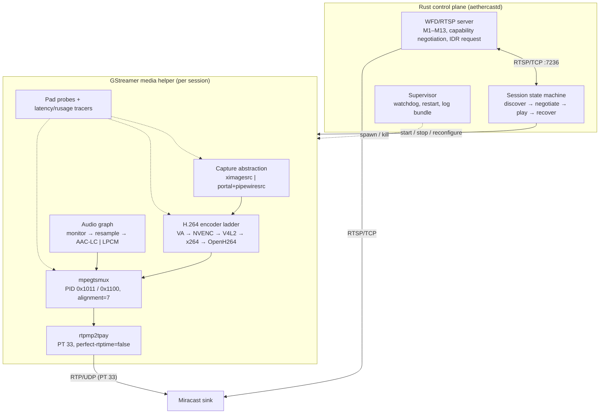

> **Naming note.** "AetherCast" is the project name. It collides with prior art in this niche (`ubports/aethercast`, Canonical's 2015 Ubuntu Miracast project). That is a known and accepted risk with an explicit rename trigger recorded in [ADR-0004](../adr/0004-name-aethercast.md).

# 03 — Media pipeline: capture, encode, mux, transport

**Status:** Research complete, pre-implementation. **Date:** 2026-10-20.
**Scope:** Screen capture, video encoding, MPEG-TS/RTP/RTSP transport, audio, A/V sync, latency, GStreamer versus a custom pipeline, measurement, and a recommended modular architecture for AetherCast (a Linux Miracast/WFD source).

**Evidence labels.** **Verified** = read in a primary source (specification, source code, official documentation) or reproduced locally. **Reported** = third-party claim, not reproduced. **Speculative** = inference, estimate or recommendation. Factual claims carry a numbered source `[n]`; local observations carry `[L n]`, with commands in §2.2.

**Test baseline.** Kali Linux 2026.2, XFCE on X11, Pentium N3710 (Braswell/CherryView), 3.7 GB RAM, one 2.4 GHz radio, PipeWire 1.6.6, GStreamer 1.28.3 with no `gst-launch-1.0`. This box has **no** ScreenCast portal backend and **no** registered `vah264enc`, so the Wayland and VA-API paths could not be exercised here — itself a finding (L5, L6, L11).

---

## 1. Executive summary

- **Capture:** one interface, two backends — `ximagesrc` on X11 (works here, no consent) and portal→`pipewiresrc` on Wayland (consent, DMA-BUF) (verified [3][4][5][8]).
- **Codec and cost:** WFD mandates H.264 CBP, forbids B-slices/CABAC, one slice per picture, HEVC optional (verified [1]).
- **Transport:** MPEG-TS over RTP/UDP, PT 33, ≤7 TS packets, fixed PIDs, PCR ≤100 ms, RTSP over TCP with the source as server on 7236, no FEC and no retransmission (verified [1], [28]).
- **Audio, framework, latency:** AAC-LC maps onto WFD's stream IDs via `mpegtsmux`, mandatory LPCM has no producer (verified [1][15][33], L6); GStreamer for media with a Rust control plane (speculative); 80–240 ms end-to-end at 720p30 is plausible but unmeasured (speculative).

## 2. Test environment and local evidence

Environment: Kali 2026.2, XFCE/X11, Pentium N3710, 3.7 GB, Intel CherryView with i965 VA-API 2.4.1, 1821×1024 root, compositing off, PipeWire 1.6.6, one 2.4 GHz radio at 2412 MHz, 40 MHz wide (verified, L2–L5).

| ID | Command | Result |
| --- | --- | --- |
| L2, L12 | `dpkg -l \| grep gstreamer1.0`; `apt-cache policy gstreamer1.0-rtsp gstreamer1.0-tools gstreamer1.0-pipewire` | 1.28.3 base/good/bad/x/libav/gl, no `gstreamer1.0-tools`; the missing rtsp/tools/pipewire packages are all in the Kali archive, so the gaps are packaging |
| L4 | `xdpyinfo`, `xrandr --current`, `xfconf-query -c xfwm4 -p /general/use_compositing` | 1821×1024 root; compositing off; DAMAGE, XFIXES, Composite present |
| L5 | `vainfo` | libva 2.23.0, i965 2.4.1; `VAProfileH264{CBP,Main,High}: VAEntrypointEncSlice` |
| L6 | GStreamer registry scan (PyGObject) + property introspection | Present: `ximagesrc`, `openh264enc`, `voaacenc`, `mpegtsmux`, `rtpmp2tpay`, `pulsesrc`, `vah264dec`. Absent: `vah264enc`, `nvh264enc`, `v4l2h264enc`, `pipewiresrc`, `x264enc`, `rtspclientsink`, `audio/x-lpcm` producers |
| L7 | `videotestsrc ! videoconvert ! openh264enc usage-type=screen complexity=0 ! fakesink sync=false` | 720p30 12 s → 14.9 s (0.81×); 1080p30 → 38.0 s (0.32×); 1080p60 8 s → 52.2 s (0.15×). `usage-type=camera`: 720p30 1.01–1.26×. Load average 5.4 |
| L8 | `ffmpeg … -c:v libx264 -preset ultrafast -tune zerolatency -b:v 4000k -g 30 -bf 0 -x264-params cabac=0:8x8dct=0 -f mpegts` | 720p30 4.54 s (2.64×); 1080p30 8.44 s (1.42×); 1080p60 8 s → 11.78 s (0.68×) |
| L9 | `grep`/`sed` over GND 0.99.0 `src/wfd/*.c` | See §7.1 |
| L10 | `iw dev`, `nmcli -f SSID,FREQ,RATE dev wifi` | `wlan0` 2412 MHz, 40 MHz, 270 Mbit/s |
| L11 | `gdbus introspect --session --dest org.freedesktop.portal.Desktop` | No `org.freedesktop.portal.ScreenCast`; only the GTK backend installed |

## 3. RQ1 — Screen capture

### 3.1 Two mechanisms, one interface

X11: `ximagesrc` reads the root window over the X11 protocol, using XDamage to limit re-reads and XFixes for the pointer (verified [5][6]); X11 has no capture consent model and the result is a CPU copy (verified [5], L6). Wayland: the compositor hands out a PipeWire stream the user selected through the ScreenCast portal, which offers `MONITOR`/`WINDOW`/`VIRTUAL` sources, multiple streams per session and `Hidden`/`Embedded`/`Metadata` cursor modes (verified [3][4]); nothing else is possible there (verified [3]). The X11 path works here; the portal path is untestable (verified, L4, L11).

### 3.2 The X11 path

`ximagesrc` "uses the XDamage extension if available to only capture areas of the screen that have changed since the last frame", uses XFixes for the pointer, defaults to 25 fps, and supports cropping and window-XID capture (verified [5]). XDamage exists to let applications track modified regions of drawables (verified [6]); Composite redirects window contents to offscreen storage (verified [7]).

- **No presentation timestamps and variable frame rate** — frames are stamped from the pipeline clock at read time (verified [5]); tearing is possible (speculative), and a static desktop yields no frames. WFD permits skipping, but a source that stops sending video must still send audio and keep PAT/PMT fresh (verified [1 §4.10.3.1]); GND carries a TODO about this (verified [37]), so a pacing element is required (speculative). Multi-monitor capture needs RandR geometry (derived).

### 3.3 The portal path

`org.freedesktop.portal.ScreenCast` is at version 6 (verified [4]). `SelectSources` takes source types, a `multiple` flag, cursor mode, restore token and persist mode; `Start` returns per-stream properties and the session opens over PipeWire (verified [3][4]). `Metadata` cursor mode keeps the pointer out of the pixels and reports it as PipeWire metadata for the client to composite (verified [4]). Since version 6 the interface warns that node ids can be reused across hotplug, resolution change and suspend/resume, asking consumers to prefer `pipewire-serial` and `PW_KEY_TARGET_OBJECT` (verified [4]); GND still connects by node id (verified [37]).

### 3.4 DMA-BUF and zero-copy

`pipewiresrc` exposes `always-copy` (default `false`), `min-buffers`/`max-buffers` and `use-bufferpool`; with copying disabled it negotiates a PipeWire buffer pool, the path on which compositor DMA-BUF descriptors reach the pipeline without a CPU round trip (verified [8]). The VA plugin operates on `video/x-raw(memory:VAMemory)` surfaces (verified [11]), so a DMA-BUF → VA chain is plausible (speculative: modifier and format negotiation is the hard part, untestable here, L6). The X11 path has no zero-copy option; its 1080p30 BGRA readback is ~249 MB/s (verified [5], derived).

### 3.5 Multi-monitor, cursor, rotation, scaling, HDR

The portal yields one stream per monitor with compositor-space geometry; X11 needs RandR arithmetic (verified [3][4], derived). v1 should stream one monitor (speculative). For the cursor, X11 `show-pointer=true` composites via XFixes (verified [5], L6) and the portal offers the three modes above (verified [4]) — recommend Embedded by default, Hidden as a privacy option (speculative). The X server rotates the root window, so `ximagesrc` sees rotated pixels, and portal stream size is in compositor coordinates and "may not be equivalent to a size in a pixel coordinate space" (verified [4]); scaling and letterboxing are `videoscale` work (L6) because the sink decodes what we send (derived). On HDR: ScreenCast v6 exposes no transfer-function metadata (verified [4]) and WFD marks 9–14-bit depth unsupported for CBP (verified [1, Table 6]), so **HDR is out of scope for v1** (speculative).

### 3.6 Capture recommendation

One interface, two implementations: `X11Capture` wrapping `ximagesrc` (crop to the monitor rectangle, `use-damage=true`, configurable pointer, caps pinned to the negotiated format) and `PortalCapture` wrapping the portal session plus `pipewiresrc` (verified [3][4][5][8]). Rule: **the capture layer never chooses the output resolution** — capture natively, then scale and letterbox once, so the backends stay interchangeable (speculative).

## 4. RQ2 — Video encoding

### 4.1 What Miracast requires (verified [1])

- A WFD device "shall use H.264 as the video CODEC", and a video-capable device "shall support 640x480 p60 with the Constrained Baseline Profile (CBP) codec of H.264 at level 3.1" (§3.4.2); levels 3.1–4.2 apply to CBP and Restricted High Profile in R1.
- Table 6 forbids, for CBP, B slices, SI/SP slices, CABAC, FMO, ASO, redundant slices, data partitioning, 4:2:2, 4:4:4 and 9–14-bit depth.
- "A WFD Source shall support transmitting video elementary stream where one picture is constructed by one slice" (§4.10.2) — **one slice per picture**.
- H.265 Main/Main 444 and Screen Content Coding are optional and R2-only (Table 7), and Windows dominates Miracast sinks (reported [24]).

The v1 target is therefore **H.264 CBP, CAVLC, no B-frames, one slice per frame, ≤ level 4.2, 8-bit 4:2:0**; HEVC, VP8, VP9 and AV1 are not Miracast codecs (verified [1]).

### 4.2 Encoder backends
| Backend | Element | Notes | Cost / licence |
| --- | --- | --- | --- |
| VA-API (Intel/AMD) | `vah264enc` | NV12 only; CBR/VBR/CQP, `bitrate` kbps, `key-int-max`, `num-slices`, `cabac`, `dct8x8` (verified [11]); the `va` plugin replaced `gstreamer-vaapi` [10] | Lowest CPU. iHD covers Gen9+ (verified [22]); CherryView is Gen8, served by i965 (L5) |
| NVENC | `nvh264enc` | Output caps include `constrained-baseline`; `zerolatency`, `rc-mode`, `bframes`, `cabac` (verified [12]) | Lowest CPU on NVIDIA |
| V4L2 M2M | `v4l2h264enc` | Kernel V4L2 encoder API, `extra-controls` tuning, often vendor-specific (verified [21]) | Low CPU on SoCs |
| x264 | `x264enc` | `pass` selects mode (`cbr=0`, `quant=4`, `qual=5`), `tune=zerolatency` (verified [14]) | Fast; GPL; in plugins-ugly (L6, L12) |
| OpenH264 | `openh264enc` | I420 in; `usage-type` (`camera=0`, `screen=1`), `complexity`, `multi-thread`, `rate-control` (verified [13]) | BSD; Cisco binaries are royalty-covered under stated conditions (reported [23]) |
### 4.3 The defaults trap

Every hardware encoder defaults outside the WFD-safe set: `vah264enc` has `cabac=true` and `dct8x8=true` (verified [11]); `nvh264enc` has `cabac=true` (verified [12]). Assert the configuration per backend, then verify the output.

| Setting | x264 | VA-API | NVENC | OpenH264 |
| --- | --- | --- | --- | --- |
| Profile, slices, B-frames, entropy, 8×8 | caps `constrained-baseline`, 1 slice, `bframes=0`, `cabac=false`, `dct8x8=false` | assert caps, `num-slices=1`, `b-frames=0`, `cabac=false`, `dct8x8=false` | caps `constrained-baseline`, 1 slice, `bframes=0`, `cabac=false`, `dct8x8=false` | caps `constrained-baseline`, `num-slices=1`, CAVLC only in CBP |
| Rate control / GOP | `pass=0` (CBR), `vbv-buf-capacity` ≈500 ms, `key-int-max=30` | `rate-control=cbr`, `bitrate` kbps, `key-int-max=30` | `rc-mode=cbr`, `gop-size=30` | `rate-control=1`, `bitrate`, `gop-size=30` |

GND 0.99.0 sets `x264enc pass=4` with the comment "constant bit rate encoding" (verified [35], L9); the x264 docs are explicit that `pass=4` is `quant` — Constant **Quantizer** — and `pass=0` is CBR (verified [14]). A real rate-control bug, and a reminder to assert settings rather than trust comments.

### 4.4 Measured cost (verified L7, L8)
| Encoder | Mode | Result | Verdict |
| --- | --- | --- | --- |
| OpenH264 | `usage-type=screen`, 4 Mbit/s | 720p30 **0.81×**, 1080p30 **0.32×**, 1080p60 **0.15×** | Not viable at 720p30 on this CPU under load |
| OpenH264 | `usage-type=camera` | 720p30 1.01–1.26× | Marginal |
| x264 | ultrafast + zerolatency, 4 Mbit/s, CABAC off | 720p30 **2.64×**, 1080p30 **1.42×**, 1080p60 **0.68×** | 720p30 comfortable; 1080p30 tight; 1080p60 no |

Caveats: load average 5.4 during both runs (L7); synthetic sources; throughput, not per-frame latency (derived); x264 used several threads, OpenH264 one (verified [35], L7).

**Recommendation (speculative, from L7/L8):** 720p30 is the v1 default **only** with x264 (GPL — acceptable if AetherCast is GPL-3.0, per note 05) or a hardware encoder; otherwise default to 960×540@30. 1080p30 requires hardware; 1080p60 is out of scope.
### 4.5 Fallback ladder

Probe at session start, in order, and record the rung used (speculative): **1.** `vah264enc` (VA-API) → **2.** `nvh264enc` (NVENC) → **3.** `v4l2h264enc` (V4L2 M2M) → **4.** `x264enc` (software, GPL; the only software rung that sustains 720p30 here, L8) → **5.** `openh264enc` (software, BSD; reduce resolution rather than drop frames, L7). Do not copy GND's list blindly: it includes `vaapih264enc`, which no longer exists in GStreamer 1.28 (verified [10][35], L9). Probe with `Gst.ElementFactory.find()` at runtime, since `vah264enc` is missing from a stock 1.28.3 install (L6).

## 5. RQ3 — Muxing and transport

Miracast is the Wi-Fi Alliance certification of WFD (verified [2]). The forward channel is **MPEG-2 TS over RTP/UDP/IP** (verified [1 §4.10.2, App. B.1]); all the following are verified [1]:

| Constraint | Value / rule | Spec reference |
| --- | --- | --- |
| RTP payload type | 33; timestamp is a 90 kHz value for the target transmission time of the first payload byte, synchronised to the PCR | App. B.1, Table 110 |
| Packetisation | ≤7 MPEG-TS packets per RTP packet; RTP + UDP + IP headers must fit the MTU (per RFC 2250 [25]) | App. B.1 |
| PIDs and cadence | PMT 0x0100, PCR 0x1000, video 0x1011, audio 0x1100–0x111F, auxiliary 0x1120–0x112F; PAT/PMT during the session; PCR-carrying TS packets "at intervals equal to or less than 100msec" | App. D.4.2, §4.10.3.1 |
| Control and media | RTSP over TCP (RFC 2326 [27]) with the WFD **Source as the RTSP TCP server**, default port 7236; RTP over UDP by default, R2 option for RFC 4571 framing | §4.10.1–2, [29] |
| Sink feedback | RTSP M13 `wfd-idr-request`; R2 buffered duration and PTS | §6.1.20, §6.1.27–6.1.28 |
| Reliability | **no FEC, no retransmission**; RFC 3550 [26] / RFC 4588 [28] mechanisms are not part of WFD | verified by reading [1] |

### 5.1 GStreamer's mapping

`mpegtsmux` exposes request pads named `sink_%d`, where the number is the decimal PID — how GND targets the WFD PIDs exactly (`sink_4113` = 0x1011 video, `sink_4352` = 0x1100 audio) (verified [15][33][35], L9); its `alignment` property documents "7 for UDP streaming" (verified [15], L6); and `rtpmp2tpay` defaults to payload type **33** and MTU 1400 (verified [16][34], L6). Packet math: 7 × 188 = 1316 bytes of TS plus 12 (RTP) + 8 (UDP) + 20 (IPv4) = **1356 bytes**, inside a 1500-byte MTU (derived from [1][26]).

Copy `perfect-rtptime=false`, which makes RTP timestamps follow transmission time and matches the WFD requirement that they represent the target transmission time of the first payload byte (verified [35], [1 Table 110]),. Drop `do-retransmission=TRUE`: it implements RFC 4588 NACK, which WFD does not define and a Miracast sink will not answer (verified [18][36], [1]).

### 5.2 Buffering: where latency comes from

| Buffer | Magnitude | Verdict |
| --- | --- | --- |
| Capture readback | 1 frame (33 ms at 30 fps) | fixed cost |
| Pre-encoder queue | GND: `max-size-buffers=1, leaky=0` (verified [35], L9) | A non-leaky queue **blocks**, adding latency under load; make it leaky and drop-oldest (speculative) |
| Encoder internal delay | OpenH264 screen mode is why GND declares 500 ms: "after e.g. scene changes the latency will be very high" (verified [35], L9) | Fix the encoder, not the knob (speculative) |
| Pipeline latency | GND: `gst_pipeline_set_latency(500 ms)` (verified [35], L9) | A 500 ms declaration widens the sink's jitter budget [19]; target <100 ms (speculative) |
| Muxer, send queue, sink | ≤100 ms PCR interval (spec, verified [1]); socket buffer; sink jitter and decode in tens to hundreds of ms | Buffers trade latency for loss; the sink dominates (speculative) |

### 5.3 Loss, retransmission, congestion control

The 2.4 GHz radio here runs a 40 MHz channel at 2412 MHz (verified, L10) — hostile for 10–20 MHz Miracast P2P links, and the same radio must share time with the STA connection (speculative). Because WFD has no FEC and no NACK (verified [1]), the only recoveries are forward repair by keyframe and rate adaptation: with a 1 s GOP one lost frame costs up to 1 s of picture, so keep `key-int-max=30`, answer `wfd-idr-request` at once, and treat "no frame for 500 ms" as an encoder fault (speculative, [1 §6.1.20], L7).

WFD leaves rate-control policy to the source: "The WFD Source may change the encoding rate depending on various factors including channel condition… the policy … is outside the scope of this specification", with two sanctioned mechanisms, implicit (compression change, frame skipping) and explicit (RTSP M4 re-negotiation) (verified [1 §4.10.3]). R1 offers no feedback beyond the IDR request; R2 adds buffered duration and PTS (verified [1 §6.1.27–6.1.28]). AetherCast should run a conservative controller over encoder queue depth, output bitrate and Wi-Fi statistics (`iw dev wlan0 link`, L10), stepping the target down 20 % at a time (speculative). Any ABR that drops video must honour the spec: the sink must have advertised support, skipped frames may not be referenced by transmitted frames, the interval must respect the sink's Max Skip Interval, and PCR must stay current (verified [1 §4.10.3.1]).

UDP is the baseline; RFC 4571-framed RTP over TCP is the R2 fallback, at the cost of head-of-line blocking (verified [1 §4.10.2], [29]; speculative).

## 6. RQ4 — Audio

### 6.1 Getting the audio

Cast the *system* mix, not the microphone. On PipeWire/WirePlumber a client links to a sink's monitor ports with `stream.capture.sink = true` (verified [9]); on the PulseAudio path the equivalent is a monitor source named `<sink>.monitor` (reported [31][32]); `pulsesrc` takes a `device` property for this (verified, L6). GND 0.99.0 creates a `module-null-sink` and captures `<sink>.monitor` from it (verified [37], L9), so the null sink is not wired to the laptop speakers and **local audio goes silent** (verified [37]).

Capture is subject to the audio server's buffering: PipeWire's quantum follows the lowest requesting client, and `PIPEWIRE_LATENCY=128/48000` gives a ≈2.6 ms quantum for native clients, while PulseAudio clients need `PULSE_LATENCY_MSEC` because "PIPEWIRE_LATENCY= does nothing for PulseAudio clients" (verified [9]) — and `pulsesrc` is a PulseAudio client (derived). Recommendation: capture the default sink's monitor when the user wants local playback to continue, otherwise a dedicated null sink for a silent laptop (speculative).

### 6.2 Codecs

| Codec | WFD status | GStreamer path | Assessment |
| --- | --- | --- | --- |
| LPCM 48 kHz/16-bit/2-ch | **Mandatory** for audio-capable devices (verified [1 §3.4.1]) | `mpegtsmux` accepts `audio/x-lpcm` but no element produces it (verified [15][33], L6) | Zero encoder delay, no patents, but needs a custom packager: the muxer's private-stream mapping (`id_extended 0x80`) is not WFD's arrangement (`stream_type 0x83`, sub-stream 0xA0) (verified [1 App. B.3], [33]) |
| AAC-LC 48 kHz, ADTS | Optional (verified [1, Tables 4–5]) | `voaacenc` emits ADTS (verified, L6); `mpegtsmux` maps AAC to `stream_type 0x0F`, `stream_id 0xC0–0xDF`, descriptor 0x2B — WFD Table 111 (verified [33], [1]) | **v1 choice**: no custom code, correct IDs, ~128–192 kbit/s |
| Opus | Not a WFD codec (verified [1]) | — | Out of scope |

LPCM is mandatory and hard, AAC is optional and easy (verified [1][33], L6); the mandatory-LPCM rule guarantees a fallback for later (speculative).

### 6.3 Resampling, clock sync, drift

Resample to `audio/x-raw, rate=48000, channels=2, format=S16LE` with `audioconvert`/`audioresample` (verified [42], L6). Video and audio share the pipeline clock, from which the muxer derives PTS/DTS and PCR (verified [15][16]); because they come from different subsystems (X server vs audio server) with independent latencies, audio usually runs *ahead* of video, so measure the offset and shift the audio branch to match reality (speculative). Lossy encoders add priming delay that must be measured, not assumed (speculative); LPCM has none. Only R2 Sinks report buffered duration and rendered PTS (verified [1 §6.1.27]); R1 has no such feedback, so R1 sync must be validated externally with a clap (verified by absence, [1]). A reasonable bound is |A/V offset| ≤ 40 ms p95 (speculative; ITU-R BT.1359 is the perceptual reference [30]).

### 6.4 Echo and routing

Capturing the system mix removes echo entirely: no microphone, nothing to cancel (derived). A microphone later would need delay-aligned acoustic echo cancellation — a project, not a setting (speculative). Routing options (all from [37] and [9]): **(1)** null sink + monitor, laptop silent, TV has sound (GND's behaviour, verified [37]); **(2)** default-sink monitor, laptop keeps playing and the TV also has sound, with the monitor tap adding audio-server buffering (derived). Recommend (1) by default, (2) when the user asks to keep local audio (speculative).

## 7. RQ5 — GStreamer versus a custom pipeline

Every media element Miracast needs is maintained upstream: `pipewiresrc` [8], `ximagesrc` [5], `vah264enc` [11], `nvh264enc` [12], `openh264enc` [13], `mpegtsmux` [15], `rtpmp2tpay` [16], `gst-rtsp-server` [20], plus latency, rusage and custom tracers for measurement [17]. GStreamer 1.28's `va` plugin is the supported VA-API path after `gstreamer-vaapi` was removed [10]. The counter-argument is packaging: runtime libraries are present but `gst-launch-1.0`, gst-rtsp-server, `pipewiresrc` and `x264enc` are not, and all are one package away in the Kali archive (verified, L2, L6, L12) — so AetherCast must ship a dependency manifest and fail with a diagnostic naming the missing element (speculative). A custom pipeline would instead require an H.264 binding, a spec-exact MPEG-TS muxer, an RFC 2250 payloader, an RTSP server with WFD's M1–M13 semantics and an LPCM PES packager (speculative judgement).

### 7.1 What GND 0.99.0 teaches (verified [35][36][37], L9)

| GND behaviour | Consequence for AetherCast |
| --- | --- |
| Hard-coded caps `1920×1080`@30 and a 4096 kbit/s ceiling (`MIN(bitrate, 512*8)`) | Negotiate with the sink; make the cap policy |
| `gst_pipeline_set_latency(500 ms)`, justified by OpenH264 screen-mode latency | The fix is a faster encoder, not a buffer |
| `x264enc pass=4` commented "constant bit rate encoding" | `pass=4` is Constant **Quantizer** [14]; variable bitrate |
| `openh264enc multi-thread=1`; pre-encoder queue `max-size-buffers=1, leaky=0` | Half the throughput on 4 cores (L7); the queue blocks instead of dropping |
| rtpbin `do-retransmission=TRUE`, `max-misorder-time=50`, `latency=40`; `pipewiresrc` connected by node id; encoder list includes `vaapih264enc`; audio via `module-null-sink` with no loopback | Receiver-side knobs on a sender object, and NACK is not in WFD; node ids deprecated since portal v6 (use `pipewire-serial`, [4]); `vaapih264enc` removed in GStreamer 1.28 [10]; local audio silently disappears |

### 7.2 Decision

**GStreamer for the media plane; AetherCast writes the control plane, the LPCM packager, the metrics collector and the supervisor** (speculative, but the only option that leaves time for the discovery/P2P work that differentiates the product). AetherCast is a Rust daemon with a per-session media helper (note 05). Two RTSP options: **A** — `gst-rtsp-server` inside the helper, subclassing `GstRTSPMediaFactory` as GND does (verified [20][35]): fastest path, but WFD semantics stay custom; **B** — RTSP in the Rust daemon with GStreamer reduced to encode → mux → `rtpmp2tpay` → `udpsink`: cleaner ownership, but RTSP, TCP-server semantics and the R2 transport switch must be re-implemented. **Recommendation: A for the MVP** (speculative).

## 8. RQ6 — Metrics, benchmarking, acceptance criteria

### 8.1 A repeatable measurement method

1. **Instrument, do not infer.** `GST_DEBUG="GST_TRACER:7" GST_TRACERS="latency(flags=pipeline+element+reported)"` gives per-element and pipeline latency, the rusage tracer CPU and memory (verified [17]); add `GstPadProbe` callbacks on the capture, encoder and muxer pads to record PTS and sequence numbers (L6).
2. **Validate the bitstream, not the pipeline.** Capture the outgoing TS with `tcpdump` (verified [39]) and analyse with `ffprobe` (verified [40]): confirm the PIDs (PMT 0x100, PCR 0x1000, video 0x1011, audio 0x1100), PCR cadence, video profile and audio stream type (verified requirements from [1]).
3. **Measure the network.** `tcpdump` on the P2P interface plus `ss -u -a`; count RTP gaps and compute jitter from the 90 kHz timestamps (verified [26][39]).
4. **Measure glass-to-glass externally.** A 240 fps camera filming a millisecond timer on the laptop and the TV together; count frames between displays — only this captures the sink's contribution (speculative method; perceptual reference [30]). Measure A/V sync with a clap in the same footage, cross-checked against the R2 playback-status query (verified [1 §6.1.27]).
5. **Inject impairment in the lab only** — `tc netem` (verified [38]) for 1–5 % loss, 20–50 ms jitter and bandwidth limits — and measure recovery to the next clean frame. Run on an idle machine, five repetitions per configuration, median and p95.

### 8.2 Metrics and proposed acceptance criteria

Targets are **speculative** proposals to be falsified, not observations.

| Metric | Definition | Target |
| --- | --- | --- |
| Glass-to-glass latency | camera-measured screen→TV delay | p50 ≤150 ms, p95 ≤250 ms at 720p30 |
| Pipeline / capture→encode latency | GStreamer latency tracer; PTS delta at the capture pad | p95 ≤60 ms; p95 ≤20 ms (no 500 ms declaration) |
| A/V sync | clap offset | ≤ ±40 ms p95 |
| Frame rate, drops, bitrate, cadence | encoded frames/s; encoder input − output; measured RTP rate vs target; PCR/PAT-PMT interval in the captured TS | ≥95 % of negotiated rate over 60 s; ≤1 % dropped; ±10 % bitrate; ≤100 ms cadence (spec), ≤50 ms internal goal |
| Packet loss, IDR response | RTP sequence gaps; `wfd-idr-request` → next IDR | <1 % sustained, recovery ≤500 ms; ≤200 ms |
| Session start, CPU, memory | RTSP OPTIONS → first decoded frame; process CPU at 720p30; RSS | p95 ≤2.5 s; ≤250 % (2.5 of 4 cores) with no throttling; <300 MB, <5 % growth over 30 min |
| Stability / fallback | 30 min session; each encoder rung | no crash or leak; every rung decodes as CBP |

### 8.3 Benchmark matrix

| Axis | Values |
| --- | --- |
| Capture / resolution | X11 `ximagesrc` and portal + `pipewiresrc` (Wayland host); 960×540@30, 1280×720@30, 1920×1080@30, 1920×1080@60 (hardware only) |
| Encoder | `vah264enc`, `nvh264enc`, `v4l2h264enc`, `x264enc`, `openh264enc` |
| Audio / network | none, AAC-LC, LPCM; clean 5 GHz, clean 2.4 GHz, 2.4 GHz +2 % loss, TCP |
| Sink | ≥2 models, one R1-only and one R2 |

## 9. RQ7 — Modular architecture and MVP

### 9.1 Architecture

### 9.2 Module contracts

| Module | Responsibility | Contract |
| --- | --- | --- |
| `capture` | frames + metadata | `Frame { seq, capture_ts, monitor_id, damage_rect, cursor }`; never rescales |
| `encode` | CBP-conformant Annex-B stream | `EncoderCaps { profile=constrained-baseline, level, fps, bitrate, gop=30, slices=1 }`; rejects configs violating WFD Table 6 [1] |
| `audio` | system mix → 48 kHz/2-ch → AAC-LC or LPCM | reports its latency so video can be offset |
| `mux` / `transport` | MPEG-TS with the WFD PID map, PCR ≤100 ms; RTP/UDP (plus TCP), PT 33, ≤7 TS packets | reports PIDs, loss, jitter, queue depth |
| `control` | WFD RTSP state machine, negotiation, IDR handling, R2 status | owns session policy; the helper owns none |
| `metrics` / `supervisor` | tracers, probes, counters; process lifecycle and watchdog | event stream → log bundle; restarts the helper, keeping session identity |

### 9.3 Clock and sync strategy

One pipeline clock per session, with the muxer deriving PCR and PTS from it (verified [15][16]). Capture timestamps come from the source: portal `do-timestamp=true` as GND does (verified [37]), X11 the pipeline clock at read time (verified [5]). Audio PTS are shifted so ordering matches physical reality, the offset measured rather than assumed (speculative). `rtpmp2tpay perfect-rtptime=false` keeps RTP timestamps reflecting transmission time (verified [35], [1 Table 110]). Never declare a large pipeline latency to hide an encoder problem (verified [35]).

### 9.4 Error recovery

| Failure | Detection | Response |
| --- | --- | --- |
| Encoder fell behind, or the stream stalls (no frame 500 ms) | queue depth and frame age at the encoder pad; watchdog on the muxer pad | drop oldest pre-encode frames (leaky queue) and count the drop; force an IDR, and if the stall persists restart the encoder element |
| Loss burst | RTP gaps from `transport` | no NACK (not in WFD, verified [1]); rely on the next IDR, shorten GOP to 15 frames, reduce bitrate |
| Sink requests IDR | `wfd-idr-request` (verified [1 §6.1.20]) | insert an IDR immediately |
| RTSP control loss, audio device gone, encoder backend vanished | transport error, source error, capability probe | tear down and re-advertise; continue video-only, since the spec allows the audio payload to carry null data (verified [1 §4.10.2]); fall back one rung in the encoder ladder |

### 9.5 MVP order

| Phase | Deliverable | Exit criterion |
| --- | --- | --- |
| 0. Media spike | `ximagesrc → x264enc (CBP) → mpegtsmux → rtpmp2tpay → filesink`, played back with ffprobe | 5-minute 720p30 TS with correct PIDs, profile, PCR cadence, no drift [40] |
| 1. Control plane | RTSP M1–M6 against a real sink; 720p30 CBP video, no audio | first frame at the sink; start ≤2.5 s; capture the sink's M3 capabilities [1] |
| 2. Audio | monitor capture → AAC-LC → `sink_4352` | A/V offset ≤ ±40 ms by clap; local-audio choice in the UI |
| 3. Fallback ladder | runtime probe of all five encoders with WFD-safe settings | every rung yields a decodable CBP stream; 1080p30 only if a rung sustains ≥1.2× realtime |
| 4. Portal, metrics, ABR, LPCM | `PortalCapture`; tracers and probes; bitrate controller; R2 status queries; LPCM PES packager | works on a GNOME/KDE host, no node-id caching (verified [4]); the §8.2 table satisfied; LPCM PES validated against App. B.3 (verified [1]) |

Do not start with HEVC, ABR, multi-monitor or HDR: each is optional in the spec (verified [1, Table 7]) and each multiplies the compatibility matrix.

## Bottom line for AetherCast

1. **GStreamer for media, Rust for control.** Every media element the protocol needs is upstream-maintained (verified [5][8][11][12][13][15][16][20]); the WFD state machine, LPCM packaging, metrics and supervision are ours (speculative).
2. **Two capture backends, one interface; X11 first.** `ximagesrc` works on this box (verified [5], L4); the portal is the only Wayland path and is not testable here (verified [3][4], L11). Prefer `pipewire-serial` over node ids (verified [4]).
3. **H.264 Constrained Baseline, 720p30, one slice per picture, 1 s GOP, CBR.** WFD mandates CBP and forbids B-slices and CABAC (verified [1]); 720p30 fits level 3.1 exactly (derived, [41]).
4. **Software encode is a 720p30-only path, and only with x264.** OpenH264 screen mode measured 0.32–0.81× realtime here, x264 2.64× at 720p30 (verified, L7, L8). 1080p30 needs hardware. Probe at runtime — `vah264enc` is missing from a stock 1.28.3 install (verified, L6).
5. **Transport: MPEG-TS over RTP/UDP, PT 33, ≤7 TS packets, WFD PIDs, PCR ≤100 ms, RTSP over TCP as the server on 7236.** No FEC, NACK or standard ABR (verified [1]); recover with fast IDRs and a conservative bitrate controller.
6. **Audio: AAC-LC in v1, LPCM later.** AAC maps onto WFD's mandated stream type and IDs through `mpegtsmux` (verified [33], [1]); LPCM is mandatory for sinks but has no producer and needs a WFD-specific PES (verified [15][33], L6). Capture the system mix; let the user choose silent-laptop or keep-local-audio.
7. **Fix GND's defects rather than inherit them:** the 500 ms pipeline latency, the non-leaky one-buffer queue, `x264enc pass=4` mislabelled as CBR, the 4096 kbit/s ceiling, `multi-thread=1`, the stale `vaapih264enc` fallback, node-id-based PipeWire connection, and the null sink that kills local audio (verified [35][36][37], L9). Promise no latency number until a camera measures it.

## Open questions

1. Which sink models will the MVP target, and do they advertise AAC-LC, 720p30 and level 3.1? The M3 capability response is ground truth and must be captured per target (verified requirement [1]).
2. Why is `vah264enc` absent here while the i965 driver advertises H.264 encode entry points (verified, L5, L6)? Is a different package, driver (iHD [22]) or rebuild required, and does that change the recommendation?
3. Does `mpegtsmux` hold PCR ≤100 ms, emit the exact WFD PIDs under load, and produce AAC that matches WFD Table 111 byte-for-byte? (Requirement verified [1]; untested locally, L2.)
4. What is the real glass-to-glass latency of the target TV, and how much is jitter buffer versus decode? This decides whether any latency target is meaningful.
5. Do the target portal backends implement ScreenCast v6 with `Metadata` cursor mode and restore tokens, and hand out DMA-BUF buffers a VA encoder can import? (Interface verified [3][4]; untested locally, L11.)
6. Can the single 2.4 GHz radio sustain a Miracast P2P link alongside the STA connection, and does the LPCM packager earn its cost? (Verified, L10.)

## Risks

| Risk | Impact and likelihood | Mitigation |
| --- | --- | --- |
| Software encode cannot sustain 720p30 on weak CPUs (verified, L7) | dropped frames, unusable sessions; high | ship x264 (GPL) as the software rung; reduce resolution, not frame rate |
| No hardware encoder in the target environment (verified, L6) | 1080p30 impossible, high CPU; medium | probe at runtime, show the active rung in the UI, require hardware encode in packaging |
| Wayland capture untested (verified, L11) | v1 unusable on modern desktops if the portal path breaks; medium | get a GNOME/KDE host early; keep the capture interface narrow so X11 ships first |
| Pacing and sparse-frame behaviour with the muxer (verified, [37] TODO) | audio stalls or PCR gaps on a static desktop; medium | pace the video branch, keep the muxer fed, assert PCR cadence |
| Lossy 2.4 GHz link (verified, L10) | visible artefacts, long recovery; high | short GOP, fast IDR, conservative ABR, offer TCP, measure recovery with `tc netem` (verified [38]) |
| Latency regression from a "fix the encoder with a buffer" reflex (verified, [35]) | 500 ms glass-to-glass; medium | cap declared pipeline latency in review; add a latency-tracer assertion to CI |
| WFD conformance drift (PIDs, PCR cadence, profile, one slice per picture) | sink refuses to play; medium | TS validator in CI (ffprobe [40]) plus byte-level checks against [1] |
| Codec licensing (OpenH264 royalty conditions reported [23]; x264 GPL; AAC/H.264 patents) | distribution risk; medium | ship x264 under GPL-3.0 (as in note 05), document the patent position, use OpenH264 binaries only where their terms apply |
| Unrestricted X11 capture (no consent model); RTSP server exposed on the P2P interface; GStreamer packaging drift (verified, L2, L6, L12) | privacy footgun; attack surface; broken builds; medium, low–medium, medium | default to the portal when available and make X11 capture an explicit opt-in; bind the RTSP server to the P2P interface and validate the WFD handshake before serving media, no TLS (WFD has none, verified [1]); pin a GStreamer version per release |

## Sources

Accessed 2026-10-20.

1. WFD Technical Specification v2.1 (2017), mirrored copy of the Wi-Fi Alliance PDF — https://raw.githubusercontent.com/wiki/albfan/miraclecast/files/Wi-Fi_Display_Technical_Specification_v2.1_0.pdf
2. Wi-Fi Alliance, Miracast overview — https://www.wi-fi.org/discover-wi-fi/miracast
3. xdg-desktop-portal, ScreenCast interface docs — https://flatpak.github.io/xdg-desktop-portal/docs/doc-org.freedesktop.portal.ScreenCast.html
4. xdg-desktop-portal, ScreenCast interface XML v6 — https://raw.githubusercontent.com/flatpak/xdg-desktop-portal/main/data/org.freedesktop.portal.ScreenCast.xml
5. GStreamer, ximagesrc — https://gstreamer.freedesktop.org/documentation/ximagesrc/index.html
6. X.Org, X Damage protocol — https://gitlab.freedesktop.org/xorg/proto/xorgproto/-/raw/master/damageproto.txt
7. X.Org, Composite protocol — https://gitlab.freedesktop.org/xorg/proto/xorgproto/-/raw/master/compositeproto.txt
8. PipeWire, gstpipewiresrc.c — https://gitlab.freedesktop.org/pipewire/pipewire/-/raw/master/src/gst/gstpipewiresrc.c
9. PipeWire, FAQ wiki — https://gitlab.freedesktop.org/pipewire/pipewire/-/wikis/FAQ
10. GStreamer, 1.28 release notes — https://gstreamer.freedesktop.org/releases/1.28/
11. GStreamer, vah264enc — https://gstreamer.freedesktop.org/documentation/va/vah264enc.html
12. GStreamer, nvh264enc — https://gstreamer.freedesktop.org/documentation/nvcodec/nvh264enc.html
13. GStreamer, openh264enc — https://gstreamer.freedesktop.org/documentation/openh264/openh264enc.html
14. GStreamer, x264enc — https://gstreamer.freedesktop.org/documentation/x264/index.html
15. GStreamer, mpegtsmux — https://gstreamer.freedesktop.org/documentation/mpegtsmux/mpegtsmux.html
16. GStreamer, rtpmp2tpay — https://gstreamer.freedesktop.org/documentation/rtp/rtpmp2tpay.html
17. GStreamer, tracing design docs — https://gstreamer.freedesktop.org/documentation/additional/design/tracing.html
18. GStreamer, rtpbin — https://gstreamer.freedesktop.org/documentation/rtpmanager/rtpbin.html
19. GStreamer, rtpjitterbuffer — https://gstreamer.freedesktop.org/documentation/rtpmanager/rtpjitterbuffer.html
20. GStreamer, GstRTSPServer — https://gstreamer.freedesktop.org/documentation/gst-rtsp-server/index.html
21. Linux kernel docs, V4L2 Encoder API — https://www.kernel.org/doc/html/latest/userspace-api/media/v4l/dev-encoder.html
22. Intel, media-driver — https://github.com/intel/media-driver
23. Cisco, OpenH264 FAQ — https://www.openh264.org/faq.html
24. Microsoft, wireless projection — https://learn.microsoft.com/en-us/windows-hardware/design/device-experiences/wireless-projection-pc-manufacturers
25. RFC 2250, RTP payload format for MPEG-1/MPEG-2 video — https://datatracker.ietf.org/doc/html/rfc2250
26. RFC 3550, RTP — https://datatracker.ietf.org/doc/html/rfc3550
27. RFC 2326, RTSP — https://datatracker.ietf.org/doc/html/rfc2326
28. RFC 4588, RTCP extended reports for NACK — https://datatracker.ietf.org/doc/html/rfc4588
29. RFC 4571, framing RTP and RTCP over TCP — https://datatracker.ietf.org/doc/html/rfc4571
30. ITU-R BT.1359, A/V sync delay — https://www.itu.int/rec/R-REC-BT.1359/en
31. Arch Wiki, PulseAudio/Examples — https://wiki.archlinux.org/title/PulseAudio/Examples
32. freedesktop.org, PulseAudio modules — https://www.freedesktop.org/wiki/Software/PulseAudio/Documentation/User/Modules/
33. GStreamer source, gstmpegtsmux.c — https://gitlab.freedesktop.org/gstreamer/gstreamer/-/raw/main/subprojects/gst-plugins-bad/gst/mpegtsmux/gstmpegtsmux.c
34. GStreamer source, gstrtpmp2tpay.c — https://gitlab.freedesktop.org/gstreamer/gstreamer/-/raw/main/subprojects/gst-plugins-good/gst/rtp/gstrtpmp2tpay.c
35. GND 0.99.0, src/wfd/wfd-media-factory.c — https://github.com/GNOME/gnome-network-displays/blob/master/src/wfd/wfd-media-factory.c
36. GND 0.99.0, src/wfd/wfd-media.c — https://github.com/GNOME/gnome-network-displays/blob/master/src/wfd/wfd-media.c
37. GND 0.99.0, src/stream/nd-stream.c — https://github.com/GNOME/gnome-network-displays/blob/master/src/stream/nd-stream.c
38. tc-netem(8) manual — https://man7.org/linux/man-pages/man8/tc-netem.8.html
39. tcpdump(1) manual — https://www.tcpdump.org/manpages/tcpdump.1.html
40. FFmpeg, ffprobe documentation — https://ffmpeg.org/ffprobe.html
41. ITU-T H.264 / AVC — https://www.itu.int/rec/T-REC-H.264/en
42. GStreamer, audioresample — https://gstreamer.freedesktop.org/documentation/audioresample/index.html

Local evidence L2, L4–L12 are listed with their commands in §2.2.
